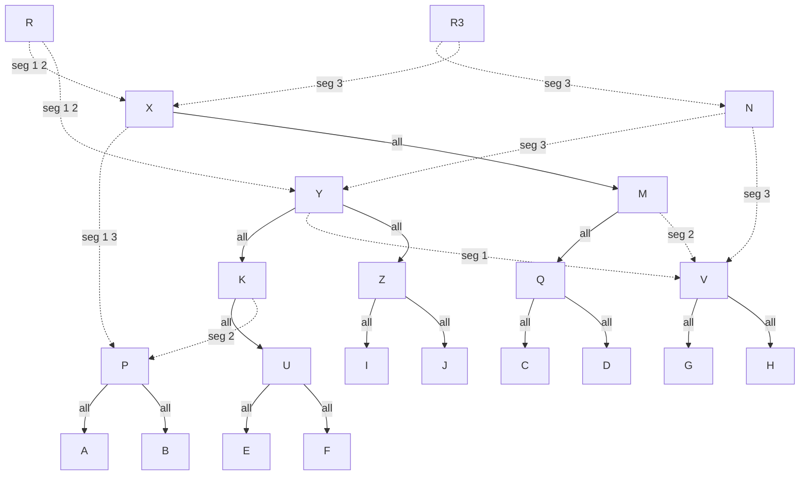

# Toy reassortment graph

A hand-made graph of 10 samples (`A`-`J`) with three segments (`seg1`: 600 sites, `seg2`: 500, `seg3`: 400). Every internal node has a name, and a name that occurs in several segment trees is the same graph node. Each edge carries a set of segments (its scope, see [kb/proposals/edge-scoped-inheritance.md](../../../kb/proposals/edge-scoped-inheritance.md)); for each segment, the edges that carry it form one tree.

Generated by [test_scripts/toy_reassortment_graph.py](../../../test_scripts/toy_reassortment_graph.py) (fixed seed); rerun it to regenerate every file.

## Graph

Edges are labeled with the segments they carry (`all` = seg1, seg2, seg3); dashed edges carry only some segments.

- **`P`** (parent of `A`, `B`): seg1 and seg3 from `X`, seg2 from `K`
- **`V`** (parent of `G`, `H`): seg1 from `Y`, seg2 from `M`, seg3 from `N`; every segment has a different parent
- **`X`, `Y`**: seg1 and seg2 from `R`, seg3 from `R3` and `N`. The graph has two roots, `R` and `R3`, because seg3 and the other segments do not share a root within the sampled history
- **Nodes that a segment passes through** (one child in that segment's tree): `X` in seg2; `K` and `M` in seg1 and seg3. They stay in the segment trees, so that an edge shared by several segments is one edge

The full edge list with lengths and scopes is in `graph.tsv`.

## Files

| File | Content |
| --- | --- |
| `tree_seg{1,2,3}.nwk` | Segment trees with named internal nodes and nodes with one child; branch lengths in substitutions per site |
| `aln_seg{1,2,3}.fasta` | Leaf sequences, simulated along each segment tree under Jukes-Cantor at rate 1 |
| `truth_seg{1,2,3}.fasta` | True sequences of every node of each segment tree, internal nodes first |
| `graph.tsv` | Edges: parent, child, branch length, segments carried |
| `nodes.tsv` | Node times (substitutions per site from `R`) and dates (`2000 + 200 * time`, so a clock rate of 0.005 per site and year) |
| `metadata.tsv` | Leaf dates |

Branch lengths equal the difference of node times, so a shared edge has the same length in every tree that contains it, and the graph is dated without error.

## Uses

- **Reading**: merging the three trees by node name must give the edges and scopes of `graph.tsv`
- **Reconstruction**: per segment, Fitch and marginal reconstruction on the combined graph must give the same states, mutations, and log-likelihood as a run on that segment's tree alone; `truth_*.fasta` measures accuracy
- **Time trees**: the true node dates are in `nodes.tsv`
