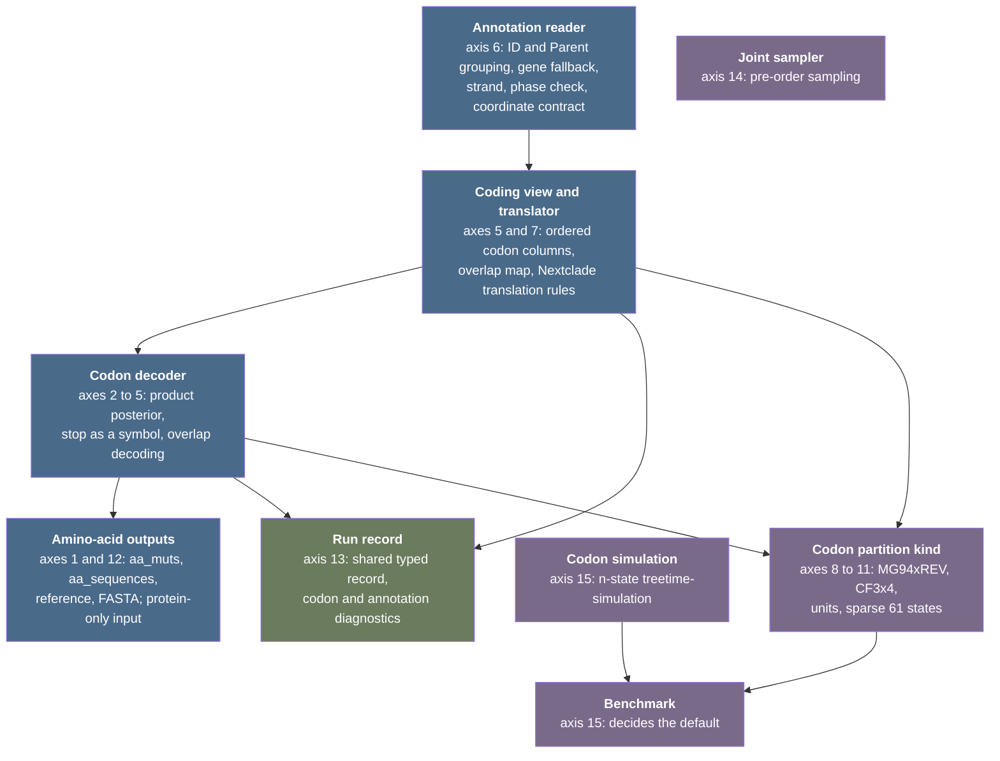

# Codon-aware ancestral reconstruction

TreeTime v1 reconstructs ancestral amino acids by a second, independent reconstruction from tip peptides (`treetime ancestral --translations`). Its amino-acid output can therefore disagree with the translation of its own nucleotide output. This proposal analyzes how TreeTime can write nucleotide and amino-acid outputs that agree at every node, and whether and how codon substitution models should enter TreeTime.

The evidence (measurements, theory, the behavior of other tools, and the literature) is in [kb/reports/codon-aware-ancestral-reconstruction.md](../reports/codon-aware-ancestral-reconstruction.md). This proposal repeats only the facts that each decision needs.

## Goal

- **Consistent outputs**: in every run with an annotation, the translation of each node's nucleotide sequence equals that node's amino-acid sequence, and every amino-acid mutation on a branch comes with a nucleotide change in that codon on the same branch. Auspice depends on such chains and shows wrong colors without an error when they break
- **Optional codon model**: a codon substitution model as a separately validated option, with a benchmark that decides whether it becomes a default
- **Commands**: `ancestral`, and `optimize` and `timetree` when they write sequences
- **Outside the scope**: GenBank annotations ([kb/issues/M-ancestral-genbank-annotation-unsupported.md](../issues/M-ancestral-genbank-annotation-unsupported.md)) and tree search

## Recommended design in brief

- **TreeTime translates its own reconstruction.** Every node gets one decoded codon per CDS codon, and both outputs come from that codon (axis 1)
- **The codon posterior comes from the nucleotide reconstruction by default.** Under site-independent models it is exactly the product of the three site posteriors, so no new likelihood code is needed (axis 2)
- **Amino acid first**: choose the most probable amino acid, with the stop symbol as a 21st symbol, then its best codon (axes 3 and 4)
- **Overlapping frames**: one nucleotide value per site; each overlap region is decoded over all its frames by an exact dynamic program (axis 5)
- **Annotations**: a GFF3 reader with the semantics that Nextclade uses, and a check that alignment columns are reference coordinates (axis 6)
- **Codon models as an opt-in partition kind**: MG94xREV with CF3x4 frequencies and maximum-likelihood parameters, after a simulation benchmark (axes 8 to 11, 15)
- **One typed run record** (`report.json`) for the CLI and the app, with codon and annotation diagnostics (axis 13)

## Notation

For one CDS codon at one node: $p(c)$ is the posterior of triplet $c$ (over the 64 triplets under option 2a, over the 61 sense [1](#gloss-1) codons under a codon model), $g$ is the genetic code, $q(a) = \sum_{g(c)=a} p(c)$ is the posterior of amino acid $a$ or of the stop symbol `*`, $r_k(n)$ is the posterior of nucleotide $n$ at codon position $k$, and $\hat c$ is the most probable triplet. A codon is diffuse [2](#gloss-2) when $p(\hat c) < 1/2$.

## Decision axes

### 1. Source of the amino-acid outputs

Today TreeTime takes amino acids from an independent reconstruction of tip peptides, which in Nextstrain pipelines are Nextclade translations.

- **1a. Translate TreeTime's own decoded codon at every node**, tips included, with the translator of axis 7 (recommended)
  - (+) **Consistent by construction**: the translation of the nucleotide output equals the amino-acid output at every node, and every amino-acid mutation on a branch comes with a nucleotide change in that codon
  - (+) **Works for every annotation shape**: overlaps, nested CDS, frameshifts, editing and splicing reduce to codon geometry. UShER `matUtils translate` uses this approach
  - (+) **One source of truth**: no peptide columns that diverge from the CDS codons at indels and frameshifts
  - (+) **Faster**: the current amino-acid route adds 2.7 to 3.0 times the time of the nucleotide run, while decoding needs 64 products per codon and node (not measured)
  - (=) **Needs a decoding rule** (axis 3) and a codon posterior (axis 2)
  - (-) **Empirical amino-acid models drop out**: JTT and similar matrices no longer enter runs with nucleotide input. An amino-acid process observed through codons is not Markovian [Kosiol and Goldman 2011](https://doi.org/10.1016/j.jmb.2011.06.005) [[1](#ref-1)], which argues for modelling at the codon level anyway
- **1b. Independent amino-acid reconstruction from `--translations`** (today)
  - (+) **Exists**, and uses empirical amino-acid models
  - (-) **Inconsistent by design**: different model, alphabet and decoding than the nucleotide output
  - (-) **Misaligned input**: Nextclade aligns each peptide to the reference peptide, so peptide columns and CDS codons diverge near indels and frameshifts
- **1c. Both, plus a consistency check**, as augur's `--report-inconsistent-translation` does
  - (-) **Reports the problem without removing it**, and keeps two sources of truth

**Recommendation**: 1a. Keep `--translations` only for CDS without nucleotide data (protein-only input), and reject a run that gives the same CDS both ways. The issue [kb/issues/M-ancestral-aa-path-ignores-method-and-include-leaves.md](../issues/M-ancestral-aa-path-ignores-method-and-include-leaves.md) then applies only to protein-only input.

> [!IMPORTANT]
> **Decision required.** The source of the amino-acid outputs changes a scientific output in every annotated run. Options: 1a (translate TreeTime's own decoded codons, `--translations` for protein-only input), 1b (keep the independent reconstruction), 1c (both with a check). Evidence: section "Measured disagreement of the two routes" of [kb/reports/codon-aware-ancestral-reconstruction.md](../reports/codon-aware-ancestral-reconstruction.md#measured-disagreement-of-the-two-routes).

### 2. Source of the codon posterior

- **2a. Product of the site posteriors of the nucleotide reconstruction** (recommended default): $p(c) \propto r_1(c_1)\, r_2(c_2)\, r_3(c_3)$ over the 64 triplets, decoded by axis 3, with stop codons competing as one more symbol (axis 4)
  - (+) **Exact under the current models**: when sites evolve independently given the tree, the branch lengths and the parameters, the joint posterior of the three nucleotides of a codon is the product of the three site posteriors. This holds for one GTR model, for codon-position partitions (`a-b\3`), for rate categories summed per site, and in v1 today. A brute-force check on a 4-tip tree matched to within 5.4e-15
  - (+) **No new likelihood code**: 64 products per codon per node, in dense and sparse runs and in every command that reconstructs nucleotides
  - (=) **The process ignores the genetic code**: the nucleotide model puts mass on stop codons and does not separate synonymous from nonsynonymous change. Codon-position partitions capture part of the rate pattern [Shapiro et al. 2006](https://doi.org/10.1093/molbev/msj021) [[2](#ref-2)]. PAML builds amino-acid posteriors in the same way and calls them "approximate" because it drops the stop mass, not because of the product
  - (-) **Conditional on the gap pattern**: in sparse runs the gaps of internal nodes come from deterministic indel ranges, and site posteriors exist only at positions without a gap ([packages/treetime/src/partition/marginal/sparse/reconstruct.rs](../../packages/treetime/src/partition/marginal/sparse/reconstruct.rs)). A codon with one or two gaps at a node has no codon posterior and needs its own rule (axis 7)
- **2b. A codon substitution model** (opt-in partition kind, axes 8 to 10)
  - (+) **The process knows the genetic code**: no history passes through a stop codon, and ω separates synonymous from nonsynonymous rates
  - (+) **Better fit**: GY94 fit 119 of 177 RNA-virus genes better than every nucleotide model [Shapiro et al. 2006](https://doi.org/10.1093/molbev/msj021) [[2](#ref-2)]
  - (-) **No accuracy evidence**: the one direct benchmark of ancestral states is a tie [Randall et al. 2016](https://doi.org/10.1038/ncomms12847) [[3](#ref-3)], and nucleotide models recover recent divergences well [Ren et al. 2005](https://doi.org/10.1080/10635150500354688) [[4](#ref-4)]
  - (-) **Cost**: a 61-state sparse partition kind, leaf state sets, unit handling (axes 9 to 11). Codons in overlaps stay outside the model (axis 5), and so do columns with tip stop codons (axis 7)
- **2c. A codon model as the default for every coding region**
  - (-) **The cost has no measured gain**, and it changes every coding site of every run

**Recommendation**: 2a as the default for every run with an annotation; 2b as an opt-in partition kind; 2c only after the benchmark of axis 15 shows a gain.

> [!IMPORTANT]
> **Decision required.** The default codon posterior decides the scientific output at every coding site. Options: 2a (product of site posteriors) as the default with 2b as an opt-in partition kind, or 2c (a codon model by default for every coding region). Evidence: sections "The codon posterior of a site-independent model" and "Accuracy of ancestral states" of [kb/reports/codon-aware-ancestral-reconstruction.md](../reports/codon-aware-ancestral-reconstruction.md#the-codon-posterior-of-a-site-independent-model).

### 3. Decoding rule

The decoding rule turns the codon posterior of one node into one codon. Under option 1a it fixes the nucleotide and the amino-acid output of that codon together. Every rule below except 3e gives consistent outputs. All of them choose the same codon where $p(\hat c) \ge 1/2$, so the choice matters only at diffuse codons. On the two shallow 2000-tip datasets, at most a few in 100,000 internal-node codon sites have a position below 1/2; the share of diffuse codons, and the share on deep trees, is not measured.

The rules follow from the loss they minimize. With the loss $\lambda \cdot \mathbb{1}[\text{amino acid wrong}] + \text{Hamming}(\text{nucleotides})$, the Bayes rule [3](#gloss-3) maximizes $\lambda\, q(g(c)) + \sum_k r_k(c_k)$: a large $\lambda$ gives 3a, $\lambda = 0$ gives 3d, and $\lambda = 0$ over sense codons gives 3c. Under the product-form posterior of option 2a, the per-site argmax [4](#gloss-4) is also the most probable triplet, so 3b, 3c and 3d reproduce today's nucleotide output except at stop triplets, and 3a changes nucleotides only in codons whose per-site argmax codes a less probable amino acid.

- **3a. Amino acid first** (recommended): choose $\hat a = \arg\max q$ over the 20 amino acids and `*`, then among its codons the one with the largest $\sum_k r_k(c_k)$, then the largest $p(c)$, then the first in alphabetical order. When values of $q$ tie within the tie tolerance of v1 (`POSTERIOR_TIE_TOLERANCE`, [packages/treetime/src/constants.rs#L5](../../packages/treetime/src/constants.rs#L5)), compare the nucleotide scores over the codons of all tied symbols
  - (+) **Lowest expected amino-acid error**, and the lowest expected nucleotide error among the codons of that amino acid (lexicographic loss [5](#gloss-5))
  - (+) **Changes nucleotides only where needed**: under 2a it keeps today's output in every codon whose per-site argmax codes the most probable amino acid
  - (+) **Cheap**: one pass over 64 triplets per codon and node
  - (-) **Changes nucleotide outputs at diffuse coding sites**: in the worked example of the report (position 1 A 0.55 or C 0.45, position 2 T, position 3 G 0.50), position 1 changes from A to C, the amino acid from Met ($q = 0.275$) to Leu ($q = 0.45$), and the expected nucleotide error rises from 0.95 to 1.05. Clade definitions and mutation counts that read nucleotides see these changes
- **3b. Most probable codon**
  - (+) **Simple**; the semantics of the codon output of HyPhy and IQ-TREE
  - (=) **Under 2a equal to today's output** except at stop triplets
  - (-) **Higher amino-acid error** at diffuse codons: 0.725 against 0.55 in the product-form example, 0.70 against 0.55 in the codon-model example of the report
- **3c. Nucleotide first**: the sense codon with the largest $\sum_k r_k(c_k)$, the constrained centroid estimator [6](#gloss-6) [Carvalho and Lawrence 2008](https://doi.org/10.1073/pnas.0712329105) [[5](#ref-5)]
  - (+) **Smallest change to today's output**: equal to the per-site argmax except where that triplet is a stop codon
  - (+) **Lowest expected nucleotide error** among sense codons
  - (-) **Amino acid not optimal**: the same Met as 3b in the product-form example
- **3d. Translate the per-site argmax** (the semantics of the translation route, no restriction to sense codons)
  - (+) **No change of nucleotide output**
  - (-) **Spurious stop codons**: the per-site argmax can be a stop triplet although an amino acid is more probable (the codon-model example of the report gives TAA, a triplet with no posterior mass), and under 2a the amino-acid error is the same as for 3b. The internal stop codons measured today are real ones and stay under 4a too
- **3e. Split decoder**: nucleotides from the most probable codon, amino acid from $\arg\max q$
  - (-) **Inconsistent outputs**. Reject
- **3f. Joint most probable codon history**, then translate (joint reconstruction [7](#gloss-7))
  - (+) **Coherent branch histories**
  - (-) **Needs a joint pass that v1 does not have**, and is not optimal per node. The joint most probable amino-acid history is a marginal MAP [8](#gloss-8) problem, NP-hard for general graphical models [Park and Darwiche 2004](https://doi.org/10.1613/jair.1236) [[6](#ref-6)]; whether the tree structure allows an exact algorithm is not known

**Recommendation**: 3a for every command that writes amino acids, through one flag that all commands share. An amino-acid error changes what users read as phenotype (branch labels, escape scores, amino-acid clade labels), while a synonymous nucleotide error changes only the nucleotide mutation list, and at a diffuse codon the nucleotide output is uncertain either way. 3c is the alternative when unchanged nucleotide outputs rank above amino-acid accuracy. The run record counts the sites where 3a, 3b and 3c differ (axis 13).

Every other output that writes coding nucleotides must use the same rule, or consistency breaks there: imputed tips (`impute_missing_data`), ambiguity codes (axis 14) and sampling (axis 14).

> [!IMPORTANT]
> **Decision required.** Option 3a changes decoded nucleotides at diffuse coding sites, against today's per-site argmax and against v0 and augur. This is a scientific difference that needs approval and an entry in `kb/decisions/`. Options: 3a (amino acid first, lowest amino-acid error), 3c (nucleotide first, smallest change of nucleotide output), 3b (most probable codon). Evidence: sections "Decoding rules from a loss function" and "Worked example under a product-form posterior" of [kb/reports/codon-aware-ancestral-reconstruction.md](../reports/codon-aware-ancestral-reconstruction.md#decoding-rules-from-a-loss-function).

### 4. Stop codons at internal nodes

Real ancestral stop codons exist: SARS-CoV-2 ORF8 Q27* sits on an internal node of clade 20I with 5 children, and 57 internal nodes of `rsv/a/2000` and 142 of `mpox/clade-ii/2000` carry stop codons that their tips share. Renormalizing over sense codons at one node does not change the amino-acid decision, because it divides every sense amino acid's $q$ by the same $1 - q(\ast)$.

- **4a. `*` competes as a 21st symbol in 3a, without conditioning** (recommended)
  - (+) **Keeps real stop codons** such as ORF8 Q27*, and the rule stays the exact Bayes rule
  - (+) **Removes spurious stop codons**: a stop triplet that wins the per-site argmax (3d) is decoded only when $q(\ast)$ beats every amino acid
  - (=) **The stop mass is a diagnostic**: a node where $q(\ast)$ is large marks a site where the nucleotide model and the genetic code disagree, or a real stop codon (axis 13)
  - (-) **Stop codons decoded from a model that ignores the genetic code** remain possible; the run record counts them
- **4b. Restrict to sense codons per node**, as PAML does
  - (=) **No effect on amino-acid decisions**
  - (-) **Forbids real stop codons**
- **4c. Exact joint conditioning on "every internal codon is a sense codon"**: 64-state pruning with the Kronecker transition matrix $P_1(t) \otimes P_2(t) \otimes P_3(t)$ of the nucleotide model and a stop indicator at internal nodes, only for codons where some node has stop mass
  - (+) **Exact for that condition**, which also changes nodes next to stop-prone nodes
  - (-) **Forbids real stop codons**, and costs about 16 times more per affected codon

**Recommendation**: 4a, with the stop mass and the decoded internal stop codons counted per CDS.

> [!IMPORTANT]
> **Decision required.** The stop rule decides whether reconstructed internal stop codons are possible. Options: 4a (stop as a symbol, real stop codons kept), 4b (sense codons only), 4c (exact conditioning). Evidence: section "Stop codons" of [kb/reports/codon-aware-ancestral-reconstruction.md](../reports/codon-aware-ancestral-reconstruction.md#stop-codons).

### 5. Overlapping reading frames, nested CDS and frameshift junctions

46 of 120 virus annotations have shifted-frame overlaps on the same strand, 6 have opposite-strand overlaps, and 10 have same-frame nested CDS. Every annotated dataset in `data/` has overlaps. No published method reconstructs ancestral states across overlapping frames, and an exact model of interlocking frames is context-dependent [Pedersen and Jensen 2001](https://doi.org/10.1093/oxfordjournals.molbev.a003859) [[7](#ref-7)].

Options for shifted-frame overlaps:

- **5a. One nucleotide value per site; decode each overlap region jointly over all its frames** (recommended): choose the nucleotide string of the region that maximizes the sum of the per-codon decoding scores (amino acid first, as in 3a) of every frame, by dynamic programming along the region, then translate every CDS from it. The objective is a chain of width-3 factors, so Viterbi with the last two nucleotides as state is exact at $O(64 \cdot L \cdot F)$ per node for $L$ sites and $F$ frames. With a codon model (2b), codons that share any nucleotide with another CDS stay in the nucleotide partition
  - (+) **Consistent in every frame**, and `*` competes as a symbol as in 4a
  - (+) **No double counting** of data, and linear cost, also for the 1.2 kb nested ORF9b
  - (+) **Covers the -1 frameshift**: in `data/sc2`, ORF1a and ORF1b share nucleotide 13468 in two frames, and both codons are still windows
  - (-) **Spliced codons break the chain**: a codon split across a long gap (influenza M2, NEP) is not a window and needs state carried across the junction or a small junction tree. This case is not tested
  - (-) **New algorithm without prior art**; the nearest work annotates viral overlaps with phylogenetic hidden Markov models [McCauley and Hein 2006](https://doi.org/10.1093/bioinformatics/btl092) [[8](#ref-8)]
- **5b. Per-site argmax in overlap regions, then translate every frame**
  - (+) **Simple**
  - (-) **Amino acids below the optimum** in either frame at diffuse sites: below the optimum of 5a in 194 of 200 random cases (random posteriors overstate the real rate)
- **5c. A primary frame decides, the other frames are translated**
  - (+) **Keeps a codon model for one long overlap** (N and ORF9b)
  - (-) **Asymmetric**: needs a choice per overlap, and stop codons can appear in the secondary frame
- **5d. An independent codon partition per CDS**
  - (-) **Counts shared data twice** (the bias that Sabath et al. describe for selection estimates [Sabath et al. 2008](https://doi.org/10.1371/journal.pone.0003996) [[9](#ref-9)]) and gives two different nucleotides for one site. Reject
- **5e. Reject overlapping annotations**
  - (-) **Fails on almost every virus**. Reject

Rules for the other shapes:

- **Same-frame nested CDS** (PA and PA-X prefix, RT p66 and p51, prM and M): one codon per genomic codon, shared by both CDS; no conflict exists
- **Frameshift and editing junctions inside one CDS**: build the codon sequence by joining the segments in translation order. A nucleotide read twice (-1 junction) is handled like an overlap (5a); a skipped nucleotide (+1 junction) belongs to no codon and keeps its nucleotide decoding
- **RNA editing** (ebola GP, mumps P and I): the re-read nucleotide stands for a nucleotide that the template does not have, so one site read twice only approximates the biology

**Recommendation**: 5a with the rules for the other shapes, with excluded codons and overlap codons counted per CDS in the run record.

> [!IMPORTANT]
> **Decision required.** The overlap policy decides the outputs of every virus with overlapping frames. Options: 5a (joint decoding over all frames), 5b (per-site argmax in overlaps), 5c (a primary frame per overlap). The approximation of RNA editing as one site read twice also needs approval. Evidence: sections "Overlapping reading frames" and "Decoding across overlapping frames" of [kb/reports/codon-aware-ancestral-reconstruction.md](../reports/codon-aware-ancestral-reconstruction.md#overlapping-reading-frames).

### 6. Annotation reader and coordinate contract

> [!WARNING]
> **Needs review.** The reader now parses GFF3 with `noodles-gff`, rejects strand `.` and `?`, builds no CDS from `gene` rows, groups rows by `ID`, validates and stores the phase, and checks the landmark length against the alignment on the partition scheme path (`--partition-by codon-positions` and `genes`). The bundled RSV and SARS-CoV-2 annotations were fixed to fit these rules. See section "Partition schemes" of [kb/decisions/multi-alignment-partitions.md](../decisions/multi-alignment-partitions.md#partition-schemes).

The reader (`fn parse_gff3_cds_features()` [packages/treetime-io/src/gff.rs#L40-L136](../../packages/treetime-io/src/gff.rs#L40-L136)) reads `CDS` rows only, groups rows by `Name` before `ID` and ignores `Parent`, rejects strand `.` and `?`, ignores the phase, sorts segments by coordinate, and compares the coordinates with nothing in the alignment. Nextclade, which produces the annotations of the Nextstrain datasets, reads all of these cases.

- **6a. Rewrite the reader with the semantics of Nextclade, plus checks** (recommended): group by `ID` and `Parent` (name as fallback); a `gene` without `CDS` acts as a CDS; `.` and `?` read as forward, with an entry in the run record; segments in biological 5' to 3' order; the phase column checked against the cumulative phase, with an error on mismatch; circular genomes wrapped. Coordinate contract: the alignment length must equal the landmark length (`##sequence-region` or the `region` row), else an error; the documented contract is that alignment columns are reference coordinates, with insertions relative to the reference removed
  - (+) **Reads the annotations of the Nextclade datasets as Nextclade does**. This is format compatibility, not a scientific choice taken from Nextclade
  - (+) **Resolves** [kb/issues/M-ancestral-node-data-annotation-drops-cds-phase.md](../issues/M-ancestral-node-data-annotation-drops-cds-phase.md)
  - (+) **Turns silent coordinate shifts into errors**: with an alignment that has insertions relative to the reference, the node data today puts annotations and mutations into different coordinates, and a decoder would shift every codon after the first insertion, both without a message
  - (-) **The forward default for `.` is a convention**, not evidence of orientation, so the run record must report it
- **6b. Fix only the two known defects** (strand and gene fallback)
  - (-) **Leaves the grouping, phase and coordinate defects**
- **6c. Also read GenBank**
  - (+) **Most Nextstrain pipelines use GenBank** ([kb/issues/M-ancestral-genbank-annotation-unsupported.md](../issues/M-ancestral-genbank-annotation-unsupported.md))
  - (-) **A second format with its own feature model**; augur 34.3.0 moves toward GFF3 in the style of Nextclade (`--use-nextclade-gff-style`)

**Recommendation**: 6a. GenBank stays a separate issue.

> [!IMPORTANT]
> **Decision required.** Three reader conventions change which inputs run: strand `.` and `?` read as forward and reported; a phase mismatch as an error; an alignment length that differs from the landmark length as an error. Evidence: sections "Annotation reader of TreeTime" and "Coordinate contract" of [kb/reports/codon-aware-ancestral-reconstruction.md](../reports/codon-aware-ancestral-reconstruction.md#annotation-reader-of-treetime).

### 7. Translation rules and tip observations

- **7.1. Translator for outputs: the Nextclade rules** (recommended): an ambiguous codon whose resolutions all code one amino acid gives that amino acid (`ACN` gives T, `YTR` gives L, `TAR` gives `*`); any other ambiguous codon or codon with one or two gaps gives `X`; `---` gives `-`; a stop codon gives `*`
  - (+) **Auspice ignores only `X`** in amino-acid mutations, so Biopython's `B`, `Z` and `J` would show as real mutations
  - (+) **Each codon translates on its own**; in augur's fallback path the translation depends on the other codons of the CDS
  - (-) **`X` for codons with several meanings loses information**: `RAY` codes Asn or Asp, which `B` keeps
- **7.2. Tip evidence under 2a** stays per site, as today. Tip amino acids are the translation of the tip's output nucleotides
- **7.3. Tip evidence in codon partitions (2b)** (recommended): an ambiguous triplet without a gap gives the set of compatible sense codons as an indicator row; a codon column in which any tip carries a stop codon stays in the nucleotide partition and is decoded by 4a; a partial gap gives a missing codon (PAML expands `-` to all four bases instead); `---` gives a missing codon plus a gap piece for the indel term. The annotated terminal stop codon is not a sense state and stays in the nucleotide partition
  - (+) **Keeps the tip stop codons and their ancestors**: a 61-state model cannot hold a stop codon at an internal node, so it would write sense codons at the 57 and 142 internal nodes that carry stop codons today, against the tips and against both current routes. IQ-TREE makes only the stop cell missing, and PAML and HyPhy drop the column, which both erase the stop codon
  - (+) **No assumption of a shared terminal stop**: in `rsv/a/20` only 11 of 20 RSV-A G sequences end at the annotated stop codon
  - (-) **The codon model loses the columns with tip stop codons**; a stop state inside a codon model is outside the standard models and unstudied
- **7.4. Frameshifted tips**: Nextclade masks the codons between a frameshifting indel and its compensating indel with `X`. A translation of reference-coordinate columns codon by codon instead reports reference-frame amino acids for a protein whose frame has changed. TreeTime needs the same detection and masking, or a documented limit
- **7.5. Codons with one or two gaps at internal nodes** (recommended rule): the indel layer decides gaps before the site posteriors, so such a codon has no codon posterior. Keep the reconstructed gap pattern, decode the positions without a gap per site, and translate the codon as `X`. Such codons are rare: 305 node-codons on `rsv/a/2000` and 288 on `mpox/clade-ii/2000`, all from frame-breaking indels reconstructed at internal nodes

> [!IMPORTANT]
> **Decision required.** The observation model of tip codons in codon partitions (7.3) and the rule for partly gapped internal codons (7.5) change scientific outputs. Options for tip stop codons: keep the column in the nucleotide partition (7.3), make only the stop cell missing (IQ-TREE), or drop the column (PAML, HyPhy). Options for partial gaps: a missing codon, or `-` expanded to all four bases (PAML). The choice of `X` over `B`, `Z` and `J` (7.1) is part of the same decision. Evidence: sections "Translation rules" and "Stop codons and ambiguous codons at tips" of [kb/reports/codon-aware-ancestral-reconstruction.md](../reports/codon-aware-ancestral-reconstruction.md#translation-rules).

### 8. Codon model family, frequencies and parameters (for 2b)

- **8a. MG94xREV with one global ω** (recommended): the MG94xREV [9](#gloss-9) model, with MG94 rates, GTR exchangeabilities, ω on nonsynonymous changes, and target-nucleotide frequencies
  - (+) **Describes skewed viral spectra**: expected SARS-CoV-2 counts at four-fold degenerate sites range from about 565 for C to T down to about 9 for T to G, which one κ cannot describe [Bloom and Neher 2023](https://doi.org/10.1093/ve/vead055) [[10](#ref-10)]
  - (+) **Nests the codon-position nucleotide model**: with ω = 1 and a code without stop codons, its generator is a Kronecker sum [10](#gloss-10) of three per-position GTR generators, which gives an exact oracle inside the project (axis 15)
  - (+) **The workhorse model of HyPhy**
  - (-) **GY-type models with F61 fit better on some data** (the HIV set of [Rodrigue et al. 2008](https://doi.org/10.1534/genetics.108.092254) [[11](#ref-11)])
- **8b. GY94 with κ**, in the M0 form [11](#gloss-11) that codeml uses
  - (+) **The default of PAML and IQ-TREE**
  - (-) **The rate of a change depends on the two unchanged nucleotides**, which Rodrigue et al. call undesirable; one κ cannot fit the spectrum; no exact nucleotide oracle
- **8c. Both configurable**
  - (=) **Doubles the test surface**; worth it only with 8a as the default

**Frequencies**: CF3x4 [12](#gloss-12) for MG94xREV (recommended); it removes the bias of F3x4 at the cost of a solver for 9 unknowns [Kosakovsky Pond et al. 2010](https://doi.org/10.1371/journal.pone.0011230) [[12](#ref-12)]. F61 only for GY94, with a floor for unobserved codons (IQ-TREE raises frequencies below 1e-4). Reject MG94 with F61: its per-position marginals are the F3x4 counts, so the option silently equals MG94 with F3x4.

**Parameters** (recommended): maximum likelihood on the fixed tree for ω, the GTR exchangeabilities and the relative rate $\mu_c$ (axis 9), started from parsimony counts, as codeml and HyPhy do. A default of ω = κ = 1 reduces MG94 almost to the codon-position nucleotide model. ω varies strongly among sites in every data set studied, influenza HA and HIV-1 included [Yang et al. 2000](https://doi.org/10.1093/genetics/155.1.431) [[13](#ref-13)], so one global ω is a first model, not an adequate one.

**Not in the first version** (recommended): rate categories among codons and instantaneous multi-nucleotide changes. Both improve fit [Whelan and Goldman 2004](https://doi.org/10.1534/genetics.103.023226) [[14](#ref-14)]; [Lucaci et al. 2021](https://doi.org/10.1371/journal.pone.0248337) [[15](#ref-15)], and some multi-nucleotide mutations recur hundreds of times in SARS-CoV-2 [De Maio et al. 2025](https://doi.org/10.1093/molbev/msaf272) [[16](#ref-16)], but no source shows an effect on ancestral states. The state space and the normalization must allow both later.

> [!IMPORTANT]
> **Decision required.** The codon model family and its frequencies decide the codon partition kind. Options: 8a (MG94xREV with CF3x4 only), 8b (GY94 with F61), 8c (both configurable). Evidence: sections "Model families" and "Codon frequencies" of [kb/reports/codon-aware-ancestral-reconstruction.md](../reports/codon-aware-ancestral-reconstruction.md#model-families).

### 9. Branch-length units and rates (for 2b)

- **9a. Normalize the codon generator to one expected nucleotide substitution per nucleotide site, use $t = 3 \mu_c b$ with the tree branch length $b$, fit $\mu_c$ by maximum likelihood, and count 3 sites per codon** (recommended) in `fn PartitionSet.total_length()` ([packages/treetime/src/partition/set.rs#L95](../../packages/treetime/src/partition/set.rs#L95)), `fn one_mutation()` ([packages/treetime/src/branch_lengths.rs#L19](../../packages/treetime/src/branch_lengths.rs#L19)), the clock, and the normalization of partition rates (`fn scale_rates_to_unit_mean()` [packages/treetime/src/optimize/partition_rates.rs#L89](../../packages/treetime/src/optimize/partition_rates.rs#L89))
  - (+) **One tree unit across partitions**, as HyPhy and IQ-TREE do; time trees work unchanged with $P(3 \mu_c \cdot \text{clock rate} \cdot \Delta t)$
  - (-) **`ancestral` must fit $\mu_c$** (a one-dimensional maximum-likelihood problem), although it keeps the input branch lengths
- **9b. Fixed factor 3 without $\mu_c$**
  - (-) **Ignores the rate difference** between coding sites and other sites
- **9c. Re-optimize branch lengths under the codon model**
  - (-) **Costly at 61 states**, and conflicts with branch lengths shared across partitions

A codon partition that receives branch lengths per nucleotide site without the factor 3 has branches 3 times too short. Histories with $k$ extra changes then lose weight by about $3^k$, so reported confidences are too high, and maximum-likelihood estimates of ω and κ are biased (derived, not measured).

### 10. Integration into the partition system

- **10a. Decoding as one step after reconstruction (for 2a)** (recommended): a coding view maps each CDS to its ordered alignment columns (strand, segments, overlaps), and one decoder writes the decoded nucleotides of coding columns and the amino acids into the sequence tracks before any writer runs. The three columns of a codon may sit in different partitions (codon-position partitions), because the product of 2a holds across independent partitions
  - (+) **One owner for decoded states**: FASTA, node data, Nexus, Auspice and MAT outputs read the same sequences
  - (+) **Works in `ancestral`, and in `optimize` and `timetree`** when they write sequences
  - (-) **The decoder must run before every writer**: today each partition emits its own pieces into the alignment assembly (`struct AlignmentLayout` [packages/treetime/src/partition/assembly.rs#L59](../../packages/treetime/src/partition/assembly.rs#L59)), so coding columns need one place where decoded codons replace the per-site states
- **10b. A first-class codon partition kind (for 2b)** (recommended) beside nucleotide partitions in one `PartitionSet`, declared by a `cds` key in `--partition` entries (the annotation can expand to such entries), with no nucleotide reconstruction of the same columns and no overlay
  - (+) **Each coding column has exactly one model**, and `optimize` and `timetree` get codon partitions through the existing partition split
  - (-) **Touches many parts**: the site layout (ordered and complemented triplets, `struct PartitionLayout` [packages/treetime/src/partition/resolve.rs#L136](../../packages/treetime/src/partition/resolve.rs#L136)), the alphabet (61 states and leaf state sets for ambiguous triplets, `struct Alphabet` [packages/treetime/src/alphabet/alphabet.rs#L20](../../packages/treetime/src/alphabet/alphabet.rs#L20)), the model enum, `total_length` and gap tracking; `--annotation` must reach `optimize` and `timetree`
- **10c. A nucleotide reconstruction of the whole alignment plus a codon overlay**
  - (-) **Counts coding data in two models**, exists only in `ancestral`, and patches outputs after the fact. Reject

Further rules:

- **Codon partitions require marginal reconstruction**
- **`--method-anc parsimony` with an annotation** means nucleotide Fitch plus translation, which is consistent by construction. Fitch over 61 codons with unit cost is not nucleotide parsimony
- **Random draws**: one random generator serves all partitions in order, so a new partition changes the samples of later partitions under the same seed
- **Model names**: codon models stay out of the global nucleotide model enum, so that commands without codon support cannot accept them

### 11. Representation and performance

- **Decoding (2a) is cheap**: 64 products and 64 comparisons per codon per node, on site posteriors that both representations already hold. The amino-acid route that it replaces costs 2.7 to 3.0 times the nucleotide run, so option 1a should make annotated runs faster than today (decoding not measured)
- **Codon partitions (2b) must be sparse**: dense 61-state storage needs 26 to 430 GB on the 2000-tip datasets
- **Three sparse costs must change before a 61-state run**: the shared per-state profiles of each message, one heap allocation per stored site, and the transition counting, which allocates an array of L by n by n per edge (`fn get_branch_mutation_matrix()` [packages/treetime/src/gtr/infer_gtr/common.rs#L132-L194](../../packages/treetime/src/gtr/infer_gtr/common.rs#L132-L194)). The fixed resolved-site threshold of 1e-4 ([packages/treetime/src/partition/marginal/sparse/message.rs#L20](../../packages/treetime/src/partition/marginal/sparse/message.rs#L20)) needs a test at 61 states
- **Web**: keep wasm32 (4 GiB cap) and estimate memory before a codon run starts; sparse codon runs up to about 2,000 tips should fit

### 12. Outputs and the consumer contract

The contract of augur node data and Auspice (checked against augur at [0dc6107](https://github.com/nextstrain/augur/tree/0dc610704848c3a472f7715a1161277ef9b625a4) and Auspice at [db211cc](https://github.com/nextstrain/auspice/tree/db211cc6b44296d92529844502a95a3e68710449)):

- **`nodes.<name>.muts`**: `<from><pos><to>`, 1-based, uppercase, no `X`; the root's list is relative to `reference.nuc`
- **`nodes.<name>.aa_muts.<cds>`**: 1-based codon index counted across joined segments; `-` and `*` allowed; the CDS keys must exist in `meta.genome_annotations`
- **`reference` and the root's `aa_sequences`** (recommended): `reference.nuc` is the root sequence when one is given, else the reconstructed root; `reference.<cds>` is TreeTime's translation of `reference.nuc`, and the root's `aa_muts` are relative to it, so one translator serves all three
- **`annotations`** with `segments`, strand and 1-based inclusive coordinates; `nuc` starts at 1 on `+`
- **Per-CDS FASTA files that include internal nodes**: the ncov, seasonal-flu and RSV pipelines read them
- **CDS names**: the augur schema for root sequences allows `^[a-zA-Z0-9*_-]+$`, while the annotation schema also allows `.`, `(` and `)`, so a name such as `ORF1a.1` passes one and fails the other. TreeTime reports such names ([kb/issues/N-io-cds-names-outside-augur-root-sequence-pattern-not-reported.md](../issues/N-io-cds-names-outside-augur-root-sequence-pattern-not-reported.md))

### 13. Run record (`report.json`)

Warnings of CLI runs go to stderr only. The app already keeps a typed run record.

- **13a. One shared typed run record for the CLI and the app** (recommended): move `struct WarningCollector` ([packages/app-backend/src/runs/warnings.rs#L4](../../packages/app-backend/src/runs/warnings.rs#L4)) to a shared crate, give the CLI a record with the fields of `struct RunRecord` (version, command, inputs with SHA-256, `config_hash`, warnings, error; [packages/app-backend/src/runs/record.rs](../../packages/app-backend/src/runs/record.rs)), and add a `diagnostics` struct with one optional named section per subsystem. The 31 untyped `progress_warn!` sites become `RunWarningKind` variants case by case
  - (+) **One schema with typed, named fields**, and no second mechanism
  - (-) **Moves code between crates**: the collector leaves `app-backend`, and each untyped warning site needs its own typed kind
- **13b. A typed payload per warning**
  - (-) **Mixes problems with routine statistics**
- **13c. A generic result list in the style of SARIF**
  - (-) **Untyped property bags**

**Per-CDS codon diagnostics** (aggregate counts): codons; codons in overlaps and in same-frame nests; tip stop codons (terminal and internal); tip codons with partial gaps, ambiguity or `---`; diffuse codons; sites where 3a differs from 3b and from 3c, and where it changes the per-site argmax; decoded internal stop codons and the summed stop mass $q(\ast)$; overlap regions where the best amino acids of the frames cannot all hold; internal codons with one or two gaps; the expected amino-acid error $\sum (1 - q(\hat a))$ and the expected nucleotide error.

**Annotation diagnostics**: strands read as forward, gene fallbacks, phase mismatches, overlaps by kind, the result of the coordinate check.

**Consumer checks**: every child mutation starts from its parent's state, and `reference` agrees with the root's mutations (Auspice only logs a mismatch).

**Per-site lists** stay outside the first version; they need their own format.

> [!IMPORTANT]
> **Decision required.** The name `report.json` collides with the homoplasy report (`--output-homoplasy-report`, `.report.txt`) and the option `--report-ambiguous`. Options: name the run record `report.json` and keep the qualified name "homoplasy report" (the option `--report-ambiguous` uses "report" as a verb), or choose another name for the run record, such as `run.json`.

### 14. Uncertainty outputs and sampling

- **14.1. Ambiguity sets from one source, anchored on the point estimate** (recommended): the amino-acid set from $q$, which always contains $\hat a$; the IUPAC code per nucleotide position from the codons that code the amino acids of that set and pass the threshold, with the decoded codon always included. A threshold on codon posteriors projected to amino acids can exclude the decoded amino acid, and a threshold per position can exclude the decoded nucleotides, so neither is a correct anchor. The amino-acid character is that amino acid when the set holds one, else `X`. Codon-level minimum posterior expected error sets [Oliva et al. 2019](https://doi.org/10.1093/bioinformatics/btz249) [[17](#ref-17)] need a loss over codon sets that no source defines
- **14.2. Sampling** (recommended): under 2a, each sample draws one triplet from the codon posterior (stop codons included, as in 4a), so each sampled node is consistent. A joint draw needs pre-order sampling [13](#gloss-13), as BEAST and HyPhy do; it is a separate issue because it also affects nucleotide runs ([kb/issues/M-ancestral-sample-from-profile-draws-nodes-independently.md](../issues/M-ancestral-sample-from-profile-draws-nodes-independently.md))
- **14.3. Expected counts**: single best reconstructions bias composition and substitution counts [Williams et al. 2006](https://doi.org/10.1371/journal.pcbi.0020069) [[18](#ref-18)]; [Krishnan et al. 2004](https://doi.org/10.1093/molbev/msh198) [[19](#ref-19)]; [Matsumoto et al. 2015](https://doi.org/10.1534/genetics.115.177386) [[20](#ref-20)]. Expected counts from edge posteriors or robust counting [14](#gloss-14) [Minin and Suchard 2008](https://doi.org/10.1007/s00285-007-0120-8) [[21](#ref-21)]; [Lemey et al. 2012](https://doi.org/10.1093/bioinformatics/bts580) [[22](#ref-22)] are the sound basis for synonymous and nonsynonymous summaries. Node data still needs point states; whether the run record also carries expected counts is open

### 15. Validation

- **15.1. Decoder tests** (defined by the specification): the two worked examples of the report with hand-derived outputs for 3a to 3d; properties over random posteriors: the translation of the decoded nucleotides equals the decoded amino acid, 3a picks $\arg\max q$, 3a keeps the per-site argmax whenever it codes $\arg\max q$, all rules agree when $p(\hat c) \ge 1/2$, and a stop codon is decoded only when $q(\ast)$ is the largest
- **15.2. Factorization oracle**: on a small tree, brute-force enumeration of all ancestral triplet assignments under the nucleotide model against the product of site posteriors, independent of the message passing
- **15.3. Overlap decoder oracle**: brute force over all nucleotide strings of short overlap regions with shifted frames, opposite strands and three frames
- **15.4. Codon model oracles**: MG94xREV with ω = 1 and a test code without stop codons against three codon-position nucleotide partitions with shared exchangeabilities (equal log-likelihoods, and codon posteriors equal to products of per-position posteriors; this also checks the factor 3 of axis 9); enumeration over $61^k$ internal assignments on a tree with 2 or 3 internal nodes; matrix properties (rows sum to 0, stationarity, detailed balance, one expected nucleotide change per site per unit time); CF3x4 reproduces the observed per-position frequencies; dense against sparse codon runs
- **15.5. Simulation benchmark before any change of default**: `treetime-simulation` supports only 4 states ([kb/issues/N-simulation-substitution-models-nucleotide-only.md](../issues/N-simulation-substitution-models-nucleotide-only.md)). It needs an n-state model, codon states mapped to triplets, and optionally rate categories and multi-nucleotide events. Compare 2a and 2b on simulated trees at the divergence of `rsv/a` and `sc2`: amino-acid and nucleotide accuracy at internal nodes, stop codons, and calibration of posteriors
- **15.6. Real data**: repeat the route comparison of the report after the change, and run the consumer checks of axis 13 on every annotated dataset

## Recommended combination

1a (TreeTime translates its own reconstruction), 2a by default and 2b as an opt-in, 3a (amino acid first), 4a (stop as a 21st symbol, no conditioning), 5a with the rules for nested CDS and junctions, 6a (a reader with the semantics of Nextclade and a coordinate contract), 7.1, 7.3 and 7.5 (Nextclade translation rules, codon observations as sense-codon sets with stop-carrying columns in the nucleotide partition, partly gapped codons as `X`), 8a (MG94xREV, CF3x4, maximum-likelihood parameters), 9a (branch length $3 \mu_c b$), 10a and 10b (one decoding step and a codon partition kind), the sparse fixes of axis 11, 13a (one shared typed run record), and 14.1 and 14.2.

Together these give consistent outputs in every run with an annotation, at almost no cost and without a new model, and they add the codon model as a separately validated option instead of a precondition.

## Order of work

- **Annotation reader, coding view, decoder and outputs** (blue) give consistent nucleotide and amino-acid outputs. They need the decisions of axes 1 to 7
- **The run record** (green) can run beside them; its codon sections need the coding view
- **Simulation, codon partition kind and benchmark** (violet) decide whether codon models earn a default. The partition kind needs the decisions of axes 7 and 8
- **The joint sampler** is independent and also fixes nucleotide sampling

## Open problems

### Scientific

- **No evidence that codon models improve ancestral states at viral divergence.** One direct benchmark is a tie [Randall et al. 2016](https://doi.org/10.1038/ncomms12847) [[3](#ref-3)]; codon models win on fit [Shapiro et al. 2006](https://doi.org/10.1093/molbev/msj021) [[2](#ref-2)]; nucleotide models recover recent divergences well [Ren et al. 2005](https://doi.org/10.1080/10635150500354688) [[4](#ref-4)]; codon-partitioned nucleotide models reproduce codon-model counts of nonsynonymous and synonymous changes within about 5% at much lower cost [Douglas and Bromham 2025](https://doi.org/10.64898/2025.12.21.695861) [[23](#ref-23)] (preprint); phylogenetic signal, not model heterogeneity, decides reconstruction accuracy [Muñiz-Trejo et al. 2025](https://doi.org/10.1093/molbev/msaf084) [[24](#ref-24)]. A codon-model default needs the benchmark of axis 15
- **Overlapping frames have no exact model.** Every option decodes a nucleotide model or keeps overlap codons out of the codon model. The overlap decoder of 5a is new, and spliced codons inside an overlap break its chain structure
- **Stop codons in codon models**: GY94 and MG94 have 61 sense states, so a codon partition cannot hold a real internal stop codon. Option 7.3 keeps stop-carrying columns in the nucleotide partition, which costs the codon model those columns
- **Gap semantics**: the indel layer fixes the gaps of internal nodes before the site posteriors, so codon posteriors are conditional on that gap pattern, and frame-breaking indels at internal nodes give partly gapped codons
- **Multi-nucleotide mutations**: a single-change codon model needs two or three separate events for a doublet or triplet change, so recurrent SARS-CoV-2 multi-nucleotide mutations [De Maio et al. 2025](https://doi.org/10.1093/molbev/msaf272) [[16](#ref-16)] are penalized
- **Non-reversible spectra**: the SARS-CoV-2 spectrum [Bloom and Neher 2023](https://doi.org/10.1093/ve/vead055) [[10](#ref-10)] is not reversible, and no reversible codon or nucleotide model captures it; the effect on ancestral states is unknown
- **Per-node point estimates are not a history**: mutation counts from them are biased [Matsumoto et al. 2015](https://doi.org/10.1534/genetics.115.177386) [[20](#ref-20)], and a joint sampler does not exist yet
- **RNA editing** is approximated as one site read twice

### Engineering

- **Coordinate contract**: with an alignment that has insertions relative to the reference, annotations and mutations use different coordinates, without a message ([kb/issues/M-ancestral-translation-annotation-not-checked-against-alignment.md](../issues/M-ancestral-translation-annotation-not-checked-against-alignment.md)). The bundled annotated datasets fit the contract; `sc2` has `gene` rows only, and ebola, influenza and dengue have no annotation in `data/`
- **Frameshifted tips** (7.4): TreeTime has no detection of frameshifting indels
- **Sparse 61-state engineering**: leaf observations as state sets, shared profiles per message, per-site allocations, and the resolved-site threshold at 61 states
- **GenBank pipelines**: most Nextstrain pipelines read GenBank, while TreeTime reads GFF3 only

### Not yet measured or checked

- **The share of diffuse codons** beyond the two shallow 2000-tip datasets; the CLI writes no site posteriors
- **ω identifiability on near-clonal data** (`data/*/20`)
- **Consumer details**: which augur and Nextclade versions the Nextstrain runtime image carries, and how `augur clades` parses `aa_muts`
- **Literature**: FastML codon output, Bloom-lab tools, BEAST 2 codon packages and Lazarus; the full texts of three accuracy studies [Aadland and Kolaczkowski 2020](https://doi.org/10.1093/gbe/evaa164) [[25](#ref-25)]; [Vialle et al. 2018](https://doi.org/10.1093/molbev/msy055) [[26](#ref-26)]; [Groussin et al. 2015](https://doi.org/10.1093/molbev/msu305) [[27](#ref-27)]

## Issues

The work items of this proposal:

- [kb/issues/M-ancestral-aa-outputs-disagree-with-translated-nucleotide-outputs.md](../issues/M-ancestral-aa-outputs-disagree-with-translated-nucleotide-outputs.md): axes 1 to 5, 7, 10a, 12 and 14.1
- [kb/issues/M-ancestral-node-data-annotation-drops-cds-phase.md](../issues/M-ancestral-node-data-annotation-drops-cds-phase.md), [kb/issues/M-io-gff3-cds-segment-order-wrong-across-circular-origin.md](../issues/M-io-gff3-cds-segment-order-wrong-across-circular-origin.md), [kb/issues/M-ancestral-translation-annotation-not-checked-against-alignment.md](../issues/M-ancestral-translation-annotation-not-checked-against-alignment.md): axis 6
- [kb/issues/M-cli-run-warnings-and-diagnostics-only-on-stderr.md](../issues/M-cli-run-warnings-and-diagnostics-only-on-stderr.md): axis 13
- [kb/issues/M-ancestral-codon-substitution-models-unimplemented.md](../issues/M-ancestral-codon-substitution-models-unimplemented.md): axes 8 to 11 and the benchmark of axis 15
- [kb/issues/N-simulation-substitution-models-nucleotide-only.md](../issues/N-simulation-substitution-models-nucleotide-only.md): the simulation of axis 15
- [kb/issues/M-ancestral-sample-from-profile-draws-nodes-independently.md](../issues/M-ancestral-sample-from-profile-draws-nodes-independently.md): axis 14.2
- [kb/issues/N-io-cds-names-outside-augur-root-sequence-pattern-not-reported.md](../issues/N-io-cds-names-outside-augur-root-sequence-pattern-not-reported.md): axis 12

Defects of the current amino-acid route that the measurement found, independent of the design:

- [kb/issues/M-ancestral-jtt92-writes-residues-at-stop-codons.md](../issues/M-ancestral-jtt92-writes-residues-at-stop-codons.md)
- [kb/issues/M-ancestral-terminal-gap-fill-acts-on-each-peptide.md](../issues/M-ancestral-terminal-gap-fill-acts-on-each-peptide.md)
- [kb/issues/N-data-translate-maps-ambiguous-codons-to-x.md](../issues/N-data-translate-maps-ambiguous-codons-to-x.md)

## Glossary

1.  **Sense codon.** One of the 61 triplets that code an amino acid in the standard genetic code. The other 3 triplets (TAA, TAG, TGA) are stop codons. [↩](#gloss-use-1)
2.  **Diffuse codon.** A codon at one node whose most probable triplet has a posterior below 1/2. Only at such codons can the decoding rules choose different codons. [↩](#gloss-use-2)
3.  **Bayes rule.** The decision that minimizes the posterior expected loss. For 0-1 loss it is the most probable state. [↩](#gloss-use-3)
4.  **Per-site argmax.** The most probable nucleotide at each alignment column of a node, chosen column by column. TreeTime writes this nucleotide in its marginal reconstruction today. [↩](#gloss-use-4)
5.  **Lexicographic loss.** A loss that ranks one error kind strictly above another: any amino-acid error costs more than every nucleotide error. It is the limit of the weighted loss for a large amino-acid weight. [↩](#gloss-use-5)
6.  **Centroid estimator.** The estimate that minimizes the expected Hamming loss. For independent components it takes the most probable value of each component [Carvalho and Lawrence 2008](https://doi.org/10.1073/pnas.0712329105) [[5](#ref-5)]. [↩](#gloss-use-6)
7.  **Joint reconstruction.** The single most probable assignment of states to all internal nodes together, computed by a dynamic program over the tree [Pupko et al. 2000](https://doi.org/10.1093/oxfordjournals.molbev.a026369) [[28](#ref-28)]. Marginal reconstruction instead gives each node its own posterior over states, from all tip data [Yang et al. 1995](https://doi.org/10.1093/genetics/141.4.1641) [[29](#ref-29)]; [Koshi and Goldstein 1996](https://doi.org/10.1007/bf02198858) [[30](#ref-30)]. [↩](#gloss-use-7)
8.  **Marginal MAP.** Maximization over some variables of a sum over the others, here the most probable amino-acid history summed over synonymous codons. It is NP-hard for general graphical models [Park and Darwiche 2004](https://doi.org/10.1613/jair.1236) [[6](#ref-6)]. [↩](#gloss-use-8)
9.  **MG94xREV.** The Muse and Gaut codon model [Muse and Gaut 1994](https://doi.org/10.1093/oxfordjournals.molbev.a040152) [[31](#ref-31)] with GTR nucleotide exchangeabilities, a nonsynonymous rate ratio ω, and the frequency of the target nucleotide in each rate. [↩](#gloss-use-9)
10.  **Kronecker sum.** The generator of three independent processes on one combined state space, $Q_1 \oplus Q_2 \oplus Q_3$. Its transition matrix is the Kronecker product of the three transition matrices. [↩](#gloss-use-10)
11.  **M0 form of GY94.** The simplified Goldman and Yang codon model that codeml uses: rate $\pi_j$, times κ for transitions and ω for nonsynonymous changes. The original model weights changes by Grantham distance and has no ω [Goldman and Yang 1994](https://doi.org/10.1093/oxfordjournals.molbev.a040153) [[32](#ref-32)]. [↩](#gloss-use-11)
12.  **F3x4 and CF3x4.** Codon frequencies as products of nucleotide frequencies per codon position. F3x4 uses the observed frequencies directly, which biases the frequencies that the model induces once stop codons are removed. CF3x4 solves for corrected nucleotide frequencies that reproduce the observed ones [Kosakovsky Pond et al. 2010](https://doi.org/10.1371/journal.pone.0011230) [[12](#ref-12)]. [↩](#gloss-use-12)
13.  **Pre-order sampling.** A draw from the joint posterior of all ancestral states: the root from its posterior, then each child from its conditional distribution given the drawn parent state and the data below the child. [↩](#gloss-use-13)
14.  **Robust counting.** Expected numbers of labelled substitutions (for example synonymous and nonsynonymous) on each branch, computed over the posterior of histories instead of from one reconstruction [Minin and Suchard 2008](https://doi.org/10.1007/s00285-007-0120-8) [[21](#ref-21)]; [Lemey et al. 2012](https://doi.org/10.1093/bioinformatics/bts580) [[22](#ref-22)]. [↩](#gloss-use-14)

## References

1.  Kosiol, Carolin, and Nick Goldman. 2011. "Markovian and non-Markovian protein sequence evolution: aggregated Markov process models." _Journal of Molecular Biology_ 411:910-923. https://doi.org/10.1016/j.jmb.2011.06.005 [↩](#cite-1)
2.  Shapiro, Beth, Andrew Rambaut, and Alexei J. Drummond. 2006. "Choosing appropriate substitution models for the phylogenetic analysis of protein-coding sequences." _Molecular Biology and Evolution_ 23:7-9. https://doi.org/10.1093/molbev/msj021 [↩¹](#cite-2a) [↩²](#cite-2b) [↩³](#cite-2c)
3.  Randall, Ryan N., Caelan E. Radford, Kelsey A. Roof, Divya K. Natarajan, and Eric A. Gaucher. 2016. "An experimental phylogeny to benchmark ancestral sequence reconstruction." _Nature Communications_ 7:12847. https://doi.org/10.1038/ncomms12847 [↩¹](#cite-3a) [↩²](#cite-3b)
4.  Ren, Fengrong, Hiroshi Tanaka, and Ziheng Yang. 2005. "An empirical examination of the utility of codon-substitution models in phylogeny reconstruction." _Systematic Biology_ 54:808-818. https://doi.org/10.1080/10635150500354688 [↩¹](#cite-4a) [↩²](#cite-4b)
5.  Carvalho, Luis E., and Charles E. Lawrence. 2008. "Centroid estimation in discrete high-dimensional spaces with applications in biology." _Proceedings of the National Academy of Sciences_ 105:3209-3214. https://doi.org/10.1073/pnas.0712329105 [↩¹](#cite-5a) [↩²](#cite-5b)
6.  Park, James D., and Adnan Darwiche. 2004. "Complexity results and approximation strategies for MAP explanations." _Journal of Artificial Intelligence Research_ 21:101-133. https://doi.org/10.1613/jair.1236 [↩¹](#cite-6a) [↩²](#cite-6b)
7.  Pedersen, Anne-Mette Krabbe, and Jens Ledet Jensen. 2001. "A dependent-rates model and an MCMC-based methodology for the maximum-likelihood analysis of sequences with overlapping reading frames." _Molecular Biology and Evolution_ 18:763-776. https://doi.org/10.1093/oxfordjournals.molbev.a003859 [↩](#cite-7)
8.  McCauley, Stephen, and Jotun Hein. 2006. "Using hidden Markov models and observed evolution to annotate viral genomes." _Bioinformatics_ 22:1308-1316. https://doi.org/10.1093/bioinformatics/btl092 [↩](#cite-8)
9.  Sabath, Niv, Giddy Landan, and Dan Graur. 2008. "A method for the simultaneous estimation of selection intensities in overlapping genes." _PLoS ONE_ 3:e3996. https://doi.org/10.1371/journal.pone.0003996 [↩](#cite-9)
10.  Bloom, Jesse D., and Richard A. Neher. 2023. "Fitness effects of mutations to SARS-CoV-2 proteins." _Virus Evolution_ 9:vead055. https://doi.org/10.1093/ve/vead055 [↩¹](#cite-10a) [↩²](#cite-10b)
11.  Rodrigue, Nicolas, Nicolas Lartillot, and Hervé Philippe. 2008. "Bayesian comparisons of codon substitution models." _Genetics_ 180:1579-1591. https://doi.org/10.1534/genetics.108.092254 [↩](#cite-11)
12.  Kosakovsky Pond, Sergei, Wayne Delport, Spencer V. Muse, and Konrad Scheffler. 2010. "Correcting the bias of empirical frequency parameter estimators in codon models." _PLoS ONE_ 5:e11230. https://doi.org/10.1371/journal.pone.0011230 [↩¹](#cite-12a) [↩²](#cite-12b)
13.  Yang, Ziheng, Rasmus Nielsen, Nick Goldman, and Anne-Mette Krabbe Pedersen. 2000. "Codon-substitution models for heterogeneous selection pressure at amino acid sites." _Genetics_ 155:431-449. https://doi.org/10.1093/genetics/155.1.431 [↩](#cite-13)
14.  Whelan, Simon, and Nick Goldman. 2004. "Estimating the frequency of events that cause multiple-nucleotide changes." _Genetics_ 167:2027-2043. https://doi.org/10.1534/genetics.103.023226 [↩](#cite-14)
15.  Lucaci, Alexander G., Sadie R. Wisotsky, Stephen D. Shank, Steven Weaver, and Sergei L. Kosakovsky Pond. 2021. "Extra base hits: widespread empirical support for instantaneous multiple-nucleotide changes." _PLoS ONE_ 16:e0248337. https://doi.org/10.1371/journal.pone.0248337 [↩](#cite-15)
16.  De Maio, Nicola, Olivier Anoufa, Kyle Smith, Yatish Turakhia, and Nick Goldman. 2025. "Highly recurrent multinucleotide mutations in SARS-CoV-2." _Molecular Biology and Evolution_ 42:msaf272. https://doi.org/10.1093/molbev/msaf272 [↩¹](#cite-16a) [↩²](#cite-16b)
17.  Oliva, A., S. Pulicani, V. Lefort, L. Bréhélin, O. Gascuel, and S. Guindon. 2019. "Accounting for ambiguity in ancestral sequence reconstruction." _Bioinformatics_ 35:4290-4297. Preprint: https://doi.org/10.1101/409029 https://doi.org/10.1093/bioinformatics/btz249 [↩](#cite-17)
18.  Williams, Paul D., David D. Pollock, Benjamin P. Blackburne, and Richard A. Goldstein. 2006. "Assessing the accuracy of ancestral protein reconstruction methods." _PLoS Computational Biology_ 2:e69. https://doi.org/10.1371/journal.pcbi.0020069 [↩](#cite-18)
19.  Krishnan, Neeraja M., Hervé Seligmann, Caro-Beth Stewart, A. P. Jason de Koning, and David D. Pollock. 2004. "Ancestral sequence reconstruction in primate mitochondrial DNA: compositional bias and effect on functional inference." _Molecular Biology and Evolution_ 21:1871-1883. https://doi.org/10.1093/molbev/msh198 [↩](#cite-19)
20.  Matsumoto, Tomotaka, Hiroshi Akashi, and Ziheng Yang. 2015. "Evaluation of ancestral sequence reconstruction methods to infer nonstationary patterns of nucleotide substitution." _Genetics_ 200:873-890. https://doi.org/10.1534/genetics.115.177386 [↩¹](#cite-20a) [↩²](#cite-20b)
21.  Minin, Vladimir N., and Marc A. Suchard. 2008. "Counting labeled transitions in continuous-time Markov models of evolution." _Journal of Mathematical Biology_ 56:391-412. https://doi.org/10.1007/s00285-007-0120-8 [↩¹](#cite-21a) [↩²](#cite-21b)
22.  Lemey, Philippe, Vladimir N. Minin, Filip Bielejec, Sergei L. Kosakovsky Pond, and Marc A. Suchard. 2012. "A counting renaissance: combining stochastic mapping and empirical Bayes to quickly detect amino acid sites under positive selection." _Bioinformatics_ 28:3248-3256. https://doi.org/10.1093/bioinformatics/bts580 [↩¹](#cite-22a) [↩²](#cite-22b)
23.  Douglas, Jordan, and Lindell Bromham. 2025. "Reconstructing substitution histories on phylogenies, with accuracy, precision, and coverage." _bioRxiv_ preprint. https://doi.org/10.64898/2025.12.21.695861 [↩](#cite-23)
24.  Muñiz-Trejo, Ricardo, Yeonwoo Park, and Joseph W. Thornton. 2025. "Robustness of ancestral sequence reconstruction to among-site and among-lineage evolutionary heterogeneity." _Molecular Biology and Evolution_ 42:msaf084. https://doi.org/10.1093/molbev/msaf084 [↩](#cite-24)
25.  Aadland, Kelsey, and Bryan Kolaczkowski. 2020. "Alignment-integrated reconstruction of ancestral sequences improves accuracy." _Genome Biology and Evolution_ 12:1549-1565. https://doi.org/10.1093/gbe/evaa164 [↩](#cite-25)
26.  Vialle, Ricardo Assunção, Asif U. Tamuri, and Nick Goldman. 2018. "Alignment modulates ancestral sequence reconstruction accuracy." _Molecular Biology and Evolution_ 35:1783-1797. https://doi.org/10.1093/molbev/msy055 [↩](#cite-26)
27.  Groussin, Mathieu, Joanne K. Hobbs, Gergely J. Szöllősi, Simonetta Gribaldo, Vickery L. Arcus, and Manolo Gouy. 2015. "Toward more accurate ancestral protein genotype-phenotype reconstructions with the use of species tree-aware gene trees." _Molecular Biology and Evolution_ 32:13-22. https://doi.org/10.1093/molbev/msu305 [↩](#cite-27)
28.  Pupko, Tal, Itsik Pe'er, Ron Shamir, and Dan Graur. 2000. "A fast algorithm for joint reconstruction of ancestral amino acid sequences." _Molecular Biology and Evolution_ 17:890-896. https://doi.org/10.1093/oxfordjournals.molbev.a026369 [↩](#cite-28)
29.  Yang, Ziheng, Sudhir Kumar, and Masatoshi Nei. 1995. "A new method of inference of ancestral nucleotide and amino acid sequences." _Genetics_ 141:1641-1650. https://doi.org/10.1093/genetics/141.4.1641 [↩](#cite-29)
30.  Koshi, Jeffrey M., and Richard A. Goldstein. 1996. "Probabilistic reconstruction of ancestral protein sequences." _Journal of Molecular Evolution_ 42:313-320. https://doi.org/10.1007/bf02198858 [↩](#cite-30)
31.  Muse, Spencer V., and Brandon S. Gaut. 1994. "A likelihood approach for comparing synonymous and nonsynonymous nucleotide substitution rates, with application to the chloroplast genome." _Molecular Biology and Evolution_ 11:715-724. https://doi.org/10.1093/oxfordjournals.molbev.a040152 [↩](#cite-31)
32.  Goldman, Nick, and Ziheng Yang. 1994. "A codon-based model of nucleotide substitution for protein-coding DNA sequences." _Molecular Biology and Evolution_ 11:725-736. https://doi.org/10.1093/oxfordjournals.molbev.a040153 [↩](#cite-32)
