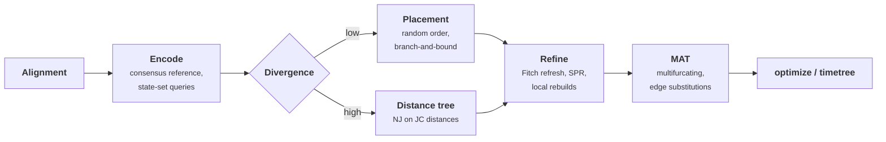

# Native parsimony tree builder

## Motivation

Every v1 command that needs a tree requires `--tree` ([kb/issues/M-timetree-tree-inference-unimplemented.md](../issues/M-timetree-tree-inference-unimplemented.md)). [kb/reports/feat-tree-infer.md](../reports/feat-tree-infer.md) surveyed tree building and recommended a native builder for low-divergence data: parsimony placement on a mutation-annotated tree (MAT), parsimony rearrangement, and then the existing `optimize` and `timetree` steps. A research prototype now exists on the branch `tree-builder` (`packages/treetime/src/build/`, about 3900 lines). [kb/reports/feat-tree-infer-prototype.md](../reports/feat-tree-infer-prototype.md) reports its measurements.

This proposal turns the prototype's findings into a design for a production builder. It covers:

- the algorithms that survived the experiments, and those that did not;
- the design decisions that remain open, with options and a recommendation for each;
- the validation and acceptance criteria;
- an implementation plan that reuses the existing machinery.

It approves nothing. A native builder diverges from v0, which only calls external programs, so each adopted option needs a decision file in `kb/decisions/`. [Issues](#issues) lists the actionable items extracted from this proposal.

## Summary

The prototype reaches the following quality, measured as Fitch parsimony:

| Data | Result |
| --- | --- |
| 32 simulated datasets with a known tree | Within 0.05% of the true tree. This holds for up to 15.6% divergence and for strong rate variation among sites |
| Five of six real datasets in `data/` | Within 0.3% of the maximum-likelihood reference trees. Two of them score below the reference |
| Lassa | 0.6% above the reference tree |

Sequential placement alone is 0.5 to 4.3% worse than the reference trees. Four elements close that gap:

1. **Exact placement.** Each sample goes where it adds the fewest substitutions. A branch-and-bound search finds that place exactly, at 14 to 34 times fewer node visits than a full scan.
2. **Random insertion order.** Orders that group similar samples, by date or by completeness, build poor backbones that later refinement does not repair.
3. **Refinement that changes internal states, not only topology.**
   - A Fitch refresh of the whole tree.
   - Exhaustive SPR that moves subtrees with their state sets.
   - Local rebuilds of every 3-branch neighbourhood.
4. **A neighbor-joining start for divergent data.** On Lassa it brings the excess over the reference tree from +3.1% to +0.6%. Sequential placement does not find the deep structure there.

The recommended design follows these findings:

- A `build` step in the core library. It returns a multifurcating tree with substitutions on its edges.
- Exposure through a `treetime build` command, and through the existing commands when `--tree` is missing.
- An automatic choice of the starting tree by divergence.
- Fixed refinement defaults.
- A dating check in the acceptance criteria.

Production use needs two engineering steps first:

- faster local rebuilds;
- a distance start whose memory does not grow with $n^2$, for more than about $10^4$ samples.

Two others are done on the branch since the first version of this proposal. The Fitch refresh runs on variable columns only, and neighbor joining uses FastTree's top hits, which removes its cubic search.

## What the prototype established

### Quality

Fitch score of the built tree relative to the reference tree in `data/`, all with state sets and rebuilds of radius 3. Conflicting splits are given in parentheses.

| Dataset | Mean p-distance to consensus | Placement, random order | Neighbor joining start | Neighbor joining and batch re-placement |
| --- | --- | --- | --- | --- |
| `flu/h3n2/500` | 0.022 | −0.07% (9) | −0.07% (9) | |
| `rsv/a/2000` | 0.014 | −0.01% (80) | +0.14% (130) | +0.14% (130) |
| `dengue/2000` | 0.049 | +0.05% (92) | +0.12% (88) | +0.08% (91) |
| `mpox/clade-ii/2000` | 0.0001 | +0.16% (82) | +0.31% (98) | |
| `sc2/4500` | 0.002 | +0.29% (291) | +0.16%, top hits | |
| `lassa/L/500` | 0.121 | +3.09% (128) | +0.96% (93) | +0.58% (84) |

On simulations with a known tree, the residual conflicting splits fall into two groups:

- At $\mu \le 0.003$ (up to 5.7% divergence) none remain.
- At higher divergence and with gamma rates ($\alpha = 0.3$), 7 to 12 remain while the score equals the true tree's. Most of them move 1 or 2 tips. Started from the true tree, the builder's moves find a better-scoring tree 2 to 3 splits away. At that point the residual reflects the parsimony criterion, not the search.

### What did not work, or was not needed

| Idea | Result |
| --- | --- |
| Greedy walk from local-branching-index (LBI) peaks | Places 2 to 85% of samples worse than the exact search on real data, by up to 1900 substitutions. It is exact only on perfect phylogenies |
| Reference nodes as starting points of the exact search | Gives the same result and saves 7 to 30% of the node visits, but no wall time. The search cost is set by the tightness of the bound, not by where the search starts |
| Voronoi cells around reference nodes with a triangle-inequality certificate | Exact, but slower; it certified only 1 to 68% of the queries. Removed |
| A separate initial-topology method for low-divergence data | Not needed. Placement starts from the reference sequence and one sample |
| Farthest-first scaffolds; scaffolds optimized over several orders | No better than random order. Reached only +2.2% on Lassa |
| Batch re-placement (prune 10% of the tips, re-place them) | Helps only on Lassa (+3.0% → +2.0% after rebuilds). Each batch needs two full Fitch passes (96 s on `sc2/4500`) |
| Larger rebuild radius (5 to 6) | Same or worse than radius 3 at 2 to 4 times the cost. The rebuild of a large ball is itself a heuristic |

### Dating

The built trees run through `clock` and `timetree` unchanged. On `sc2/4500`:

- **Rooted on Wuhan-Hu-1**, the latest builder agrees with the reference tree. The clock rate is 9.95e-4 against 1.04e-3, and the median root-to-tip difference is −2 substitutions.
- **Least-squares rerooting** differs: 7.4e-4 against 9.1e-4, and a root date of 2019.01 against 2019.81. Polytomies do not explain this, because collapsing the reference tree's empty branches leaves its estimate unchanged.
- **Insertion order** changed the clock estimates more than the parsimony score in earlier versions. Two orders whose trees differed by 9 substitutions gave root-to-tip shifts of +24 and −12 substitutions.

Parsimony and split agreement do not detect these differences.

## Proposed design

### Pipeline

### Representation

A MAT holds:

- the reference sequence $R$ of the root;
- a sorted list of substitutions per edge;
- the sample at each leaf;
- the total parsimony score;
- for every node $v$, an upper bound $d(v)$ on the number of substitutions on any path from $v$ to a leaf.

The state of a node is $R$ with the substitutions of its path applied. Internal states are never stored in full during placement and SPR. Memory therefore scales with the number of substitutions, not with $n \times L$.

The reference is the per-site majority state of the alignment. Each sample is encoded as a **query**: a sorted list of (position, state set) for the sites that differ from $R$, plus ranges of missing sites. Missing sites are `N`, gaps, and other characters without a state. Ambiguity codes enter as their state sets, as in Fitch.

Gaps are treated as missing data, so the builder does not place indels. This matches the rule for UShER MAT input in [kb/decisions/io-usher-mat-gaps-as-missing-data.md](../decisions/io-usher-mat-gaps-as-missing-data.md).

### Placement score

Let $q$ be a query and $v$ a node with state $S_v$. The cost of attaching $q$ below $v$ is the number of observed sites at which $q$ excludes the state of $v$:

$$
c(v) = \sum_{s \notin \mathrm{miss}(q)} \left[ S_v(s) \notin q(s) \right]
$$

Moving from a parent $p$ down the edge $e$ to the child $u$ changes the cost only at the sites that $e$ substitutes:

$$
c(u) = c(p) + \sum_{(s,\, a \to b) \in e} \Big( [b \notin q(s)] - [a \notin q(s)] \Big)
$$

Here $q(s)$ is the full alphabet at a missing site, so missing sites contribute nothing. Splitting $e$ after the substitutions that $q$ shares with it costs $c(p) - \mathrm{shared}(e, q)$.

Reversions and repeated hits at a site are handled exactly: the score always compares the query with the actual state at both ends of each substitution. During SPR, an internal error is raised if the placement score of a subtree disagrees with the cost of its insertion, or if a move raises the total score.

### Exact placement by branch and bound

Each substitution changes $c$ by at most one. Every placement in the subtree of $v$ therefore costs at least

$$
c(v) - d(v)
$$

The search goes depth-first from the root. It visits children in order of their bound, and prunes a subtree whose bound is not below the best cost found so far. $d(v)$ only needs to be an upper bound, so:

- an insertion raises it along the path to the root;
- a deletion leaves it unchanged.

Ties are broken deterministically: first a preferred target (the current place during SPR), then a node over an edge, then the lower key.

Samples are placed in batches against a frozen tree, in parallel. A sample whose target changed earlier in the same batch is placed again.

### Insertion order

The default order is random, seeded per run under the rule of [kb/decisions/cli-seed-on-commands-with-random-steps.md](../decisions/cli-seed-on-commands-with-random-steps.md). Date order, which [feat-tree-infer.md](../reports/feat-tree-infer.md) recommended, ended 1.8 to 2.9% above random order on the rate-variation simulation, after the same refinement.

### Starting tree for divergent data

The distance start runs neighbor joining on Jukes-Cantor distances. Each distance uses the sites observed in both samples, and ambiguity sets count as matches when they intersect. The NJ topology is converted to a MAT by one Fitch pass and then refined like a placement tree.

Neighbor joining is decisive on Lassa (+3.1% → +0.96%). It is also slightly better on `sc2/4500` (+0.16% against +0.29%), and slightly worse on `rsv/a/2000`, `dengue/2000`, and `mpox/clade-ii/2000` (by 0.07 to 0.15%).

The pair search uses FastTree's top hits. Each node keeps the $m \approx \sqrt n$ partners that are best by the joining criterion, and caches its best partner among them. A joined node inherits its children's lists and enters its partners' lists, and every list is rebuilt every $m$ joins. This gives trees identical to exact neighbor joining on `lassa/L/500` and `dengue/2000`, at $O(n^3/m)$ time; `sc2/4500` takes 17 s. The full distance matrix still costs $O(n^2)$ memory, about 0.8 GB at $10^4$ samples.

**Local neighbor joining does not replace the global start.** Adding a neighbor-joining candidate to every local rebuild:

- changes nothing on low-divergence data;
- on Lassa, removes a third to a half of the excess of the placement trees (+3.09% → +1.28 to +2.49% at radius 5), but stays above the global NJ start;
- combined with the global NJ start, gives the best Lassa tree so far (+0.55%).

The errors that sequential placement makes on Lassa are not local at the scale that a ball of up to 64 pseudo-leaves holds. See [kb/reports/feat-tree-infer-prototype.md](../reports/feat-tree-infer-prototype.md#fast-and-local-neighbor-joining).

### Refinement

One refinement round runs these steps until a round brings no gain:

1. **Fitch refresh.** `fn create_fitch_partition()` runs on the current topology, and the reference and all edge substitutions are rebuilt from canonicalized Fitch states. This step brings the largest single gain (0.6 to 7%), because placement fixes internal states greedily. All queries are re-encoded against the new reference.
2. **Exhaustive SPR.** Every subtree is detached in postorder and re-placed by the exact search. An internal subtree moves with the plurality set of its children at sites where they disagree. After the move, its root takes a state from that set and its child edges are rewritten (`fn Mat.restate()`). A move is accepted only if it lowers the score; ties keep the old place.
3. **Local rebuilds.** For every internal node, the ball of radius 3 branches is cut out. Nodes at distance 3 and samples inside the ball become pseudo-leaves with their state sets. The interior is rebuilt by exact placement in 4 orders followed by SPR, and the rebuild is spliced in only if it needs fewer substitutions. Balls with more than 24 pseudo-leaves are skipped.

A rebuild changes several subtrees and their internal states at once, which single-subtree SPR cannot do. It is what brings the simulated trees to the true-tree score.

Batch re-placement and larger radii stay optional. Neither changed the result after rebuilds except on Lassa.

### Output

The builder returns the MAT. Edges without substitutions are collapsed, so the tree is multifurcating where the data do not resolve it.

The MAT converts directly to a `Graph` with edge substitutions, which is the input the `optimize` and `timetree` pipelines need. Branch lengths in substitutions per site are a starting value only; `optimize` replaces them with ML branch lengths. The existing UShER MAT writer can store the result for incremental updates.

## Design axes

Recommendations are marked; each is open until the team approves a decision file.

### B1. Entry point

- **B1a. [recommended] `treetime build` command plus fallback.** A new command writes Newick and MAT. Commands that accept `--tree` build a tree when it is missing, with the same defaults, and log that they did.
- **B1b. `treetime build` only.** Keeps every other command's contract unchanged; users chain two commands.
- **B1c. Fallback only.** No standalone command, so the builder cannot be validated or reused on its own.

### B2. Starting tree and divergence rule

- **B2a. Placement always.** Simple. Leaves Lassa-like data 3% above the reference tree.
- **B2b. [recommended] Threshold on the mean p-distance to the consensus.** Placement below the threshold, distance start above it. In `data/`, placement is as good or better up to 0.049 (dengue) and the distance start is better at 0.121 (Lassa). A threshold between these needs more divergent test sets, simulated with gamma rates, to place it.
- **B2c. Both starts, keep the better.** Robust, and with top hits affordable up to about $10^4$ samples. It roughly doubles the cost, and gains at most 0.15% outside Lassa.
- **B2d. Refuse divergent data.** As [feat-tree-infer.md](../reports/feat-tree-infer.md) recommended. The prototype shows the native builder within 0.6% on Lassa, so this is no longer necessary.

Above about $10^4$ samples the distance matrix no longer fits in memory. Options:

- **Profiles instead of the matrix,** as FastTree does: $O(n \sqrt n)$ memory and $O(n \sqrt n \log n)$ time for the joins.
- **NJ on a subsample, then placement of the rest.** The scaffold experiments suggest that the deep structure from NJ on a few hundred samples may suffice. Untested.
- **Placement onto a distance-built backbone of the most divergent clades.**

### B3. Refinement schedule

- **B3a. [recommended] Fixed default.** Refresh, SPR, and radius-3 rebuilds until no gain, then stop. Batch re-placement and radius are expert options.
- **B3b. Time budget.** Continue with batch re-placement or random restarts until a time limit. Not reproducible across machines.
- **B3c. Multiple random orders, keep the best.** On Lassa, five orders ended 2.0 to 3.4% above the reference tree. Restarts reduce variance but do not replace a better start.

### B4. Neighbourhood of a local rebuild

- **B4a. Radius in branches (prototype).** Works on all datasets except `sc2/4500`. There, 41% of misplaced tips lie more than 10 branches from their split, but only 11 substitutions away (median), along ladders of single-substitution branches.
- **B4b. [recommended to test] Radius in substitutions, capped by node count.** Matches the error locality on ladder trees. Needs a size cap for polytomies: about a third of the radius-5 balls exceed 48 pseudo-leaves on `sc2/4500` and `mpox`.
- **B4c. Balls around high-homoplasy sites.** Target the rebuilds at regions where the per-site Fitch counts indicate conflict. Cheaper, but needs a rule for selecting the regions.

### B5. Representation for the Fitch refresh

**Done on the branch.** The refresh encodes each leaf from its sparse query and runs `fn create_fitch_partition()` only on the columns where some sample differs from the reference. Every other column keeps the reference state. Scores are identical to the full refresh, and the build of `mpox/clade-ii/2000` takes 13 s instead of 24 s.

The remaining memory peak (0.9 GB on mpox) comes from holding the alignment. The builder needs only the queries, so a streaming reader that encodes each sequence as it is read would remove it. This is the parsimony part of [kb/proposals/mutation-first-sequence-representation.md](mutation-first-sequence-representation.md).

### B6. Polytomies and binary output

- **B6a. [recommended] Multifurcating output.** Empty edges are collapsed, and `timetree` resolves polytomies with dates, as the TreeTime paper prescribes. Requires a fix of [kb/issues/M-timetree-polytomy-resolution-fails-on-backward-branch.md](../issues/M-timetree-polytomy-resolution-fails-on-backward-branch.md), which built trees reach deterministically.
- **B6b. Arbitrary binary resolution.** Needed only for external programs that reject polytomies.

### B7. Support values

- **B7a. [recommended] Count of equally parsimonious placements per sample.** The branch-and-bound already sees all ties at the optimal cost, so the count is nearly free. This is UShER's measure.
- **B7b. SPRTA-style probabilities.** Requires likelihood scores; deferred.

### B8. Incremental update

- **B8a. [recommended] Place new samples onto a saved MAT, then refine locally.** The placement and the local rebuilds work on any MAT. The existing UShER MAT reader and writer provide the format. The rebuilds should be limited to balls that contain new samples.
- **B8b. Build from scratch only.**

### B9. Dating in the acceptance criteria

- **B9a. [recommended] Required.** Clock rate, root date, and node-date intervals on simulated data with known dates must match those obtained on the true topology within a stated tolerance. On real data, compare them with a reference tree. Parsimony and splits alone missed differences of 20% in the clock rate.
- **B9b. Parsimony and splits only.**

## Validation

### Correctness tests (in the crate)

- **Perfect phylogeny.** With infinite-sites mutations, every mode recovers the true informative splits, and the score equals the number of mutations. This test exists.
- **Oracle.** The branch-and-bound equals the full scan on data with homoplasy and missing data. This test exists.
- **Consistency of incremental and direct scores.** After every placement, SPR move, splice, and restate, the MAT score must equal the Fitch score of the same topology. Today only the placement score is checked against the insertion cost; the comparison with Fitch should become a property test.
- **Closed forms.** LBI and eccentricity on small trees, and NJ on an additive metric. These tests exist.

### Benchmark suite (outside the test suite)

**Simulated data.** Use the v1 simulator with gamma rates (`examples/simulate_dataset.rs`) on this grid:

| Parameter | Values |
| --- | --- |
| $\mu$ | 0.001, 0.003, 0.01, 0.03 |
| $\alpha$ | equal rates, 1.0, 0.3 |
| Observation | clean, messy |
| Tips | 400, 1200, 5000 |
| Replicates | 2 |

Report for each run:

- the Fitch score relative to the true tree;
- the recall and precision of informative splits;
- conflicting splits and their locality;
- clock estimates against the true clock and against those on the true topology.

**Real data.** The `data/` families, compared with their ML trees and with IQ-TREE and CMAPLE runs on the same alignments:

- Fitch score;
- log-likelihood after `optimize`;
- clock estimates under outgroup and least-squares rooting.

**Scaling.** Runtime and memory at 10^3, 10^4, and 10^5 samples (SARS-CoV-2 subsamples).

### Acceptance criteria (proposed)

- Simulations at $\mu \le 0.01$: within 0.1% of the true tree's Fitch score.
- Low-divergence `data/` families: within 0.3% of the reference tree's Fitch score.
- Clock rate and root date on simulations within the spread of the estimates from the true topology.
- `sc2/4500` built in under 60 s on 12 cores, with memory below the alignment size times 2.

## Performance

Measured on 12 cores, `sc2/4500` (5100 samples, 29,903 sites):

| Stage | Time |
| --- | --- |
| Placement | 1.1 s |
| SPR | 2 s |
| Fitch refreshes | 10 s |
| Rebuilds of radius 3 with state sets | 85 s |

Where the cost lies:

- **Rebuilds.** They are 2 to 4 times slower with state sets, because the plurality sets of every pseudo-leaf are recomputed for every ball. Caching the sets per node between balls, and rebuilding only balls whose members changed since the last round, should recover most of this.
- **Input.** The alignment is held in full while the queries are encoded (see B5).
- **Placement bound.** $d(v)$ counts every substitution below $v$, although the query can gain only at sites where it differs from $v$. A bound restricted to the sites of the query would prune more. This matters at 10^5 samples, where the exact search visits a growing share of the tree.
- **Polytomies.** `fn Graph.add_edge()` checks all children of the source for a duplicate edge, which is linear in the size of a polytomy. Large polytomies are common in SARS-CoV-2 trees.
- **SPR.** It runs on one thread.

For 10^5 samples and more, a seed of the branch-and-bound may become worthwhile again, from reference nodes or the parent's placement. It must keep the exact search as its fallback.

## Open research questions

- **Least-squares root on built trees.** Why does least-squares rerooting of the built `sc2/4500` tree give a 20% lower clock rate, when the outgroup-rooted estimates agree? The candidates are the 1364 tips whose root-to-tip distance differs by more than 5 substitutions, and substitution-reversion pairs on the backbone. A simulation with known dates decides which tree gives the better estimate.
- **Moves that change a subtree's root state.** State sets cover sites where the children disagree. A move that needs a state that none of the children has is still not found. matOptimize searches the full Fitch set.
- **Time-aware refinement.** Among equally parsimonious placements, choose the one that is most consistent with the sampling dates, for example by the root-to-tip residual. This would address the dating sensitivity at no parsimony cost.
- **Sparse-likelihood refinement.** After the parsimony tree, a MAPLE-style likelihood SPR on the sparse partition would rank the equally parsimonious trees. It needs the dense-sparse agreement of [kb/issues/H-timetree-sparse-dense-node-times-differ.md](../issues/H-timetree-sparse-dense-node-times-differ.md).
- **Divergence threshold.** Where between p = 0.05 and 0.12 does the distance start become better? Answering this needs simulations at $\mu$ = 0.02 to 0.03 with gamma rates, and further divergent real datasets.

## Implementation plan

The prototype code is the starting point. Each stage lands with tests and a kb update.

| Stage | Content | Prototype status |
| --- | --- | --- |
| 1. Core | `Query`, `Mat`, exact placement, SPR, Fitch refresh, rebuilds, random order; `build_mat()` with fixed defaults | Implemented; remove the experiments that did not pay off (greedy walk, reference search, scaffolds, cells) or move them behind a feature for research |
| 2. Representation | Fitch refresh on variable sites only (B5); streaming encoding of the input | Refresh done |
| 3. Distance start | Top-hits NJ, divergence rule or both starts (B2); a matrix-free method above $10^4$ samples | Top-hits NJ done |
| 4. Command | `treetime build` with `--seed`, Newick and MAT output, a log of the stage scores; `--tree` fallback (B1) | Example program only |
| 5. Downstream | Fix the polytomy-resolution error; run `optimize` and `timetree` on built trees in the comparison harness | Error reproduced |
| 6. Support and update | Placement counts (B7a), incremental placement (B8a) | Not started |
| 7. Benchmarks | The suite of [Validation](#validation), stored as reports | Partly run by hand |

What can be reused or generalized instead of duplicated:

- `fn create_fitch_partition()` for the refresh and for scoring any topology;
- `fn jukes_cantor_distance()` for the distances;
- `fn find_letter_ranges_by()` for missing ranges;
- `Sub` and `fn compose_substitutions()` for edge lists;
- the UShER MAT reader and writer in `packages/treetime-io` and `packages/app-output`;
- `fn merge_shared_mutation_branches()` and the polytomy moves of `optimize`. The exhaustive SPR covers these moves, so `optimize` need not repeat them on a built tree.

Graph changes made by the prototype:

- `fn Graph.remove_edge()` and `fn Graph.remove_node()` now take time proportional to the node degree;
- `Graph` has a manual `Clone`.

These are general improvements and can merge independently.

## Impact

- **New scientific output.** An inferred topology. Every command that accepts `--tree` produces different results from the same alignment depending on whether the tree came from IQ-TREE or from the builder. The divergence from v0 (external programs) needs a decision file.
- **No change for runs with `--tree`.**
- **New dependency: none.** The prototype uses only existing crates.
- **Simulator.** The v1 simulator gained gamma site rates (`fn gamma_site_rates()`, `fn evolve_sequences_with_rates()`). `fn evolve_sequences()` keeps its behaviour.

## Issues

Actionable items from this proposal:

- [M-build-neighbor-joining-quadratic-memory.md](../issues/M-build-neighbor-joining-quadratic-memory.md)
- [M-build-no-rule-to-choose-distance-or-placement-start.md](../issues/M-build-no-rule-to-choose-distance-or-placement-start.md)
- [M-build-rebuild-radius-in-branches-misses-ladder-errors.md](../issues/M-build-rebuild-radius-in-branches-misses-ladder-errors.md)
- [M-build-least-squares-root-differs-on-built-sc2-tree.md](../issues/M-build-least-squares-root-differs-on-built-sc2-tree.md)
- [N-build-local-rebuild-slow-with-state-sets.md](../issues/N-build-local-rebuild-slow-with-state-sets.md)
- [N-build-placement-bound-counts-all-substitutions-below.md](../issues/N-build-placement-bound-counts-all-substitutions-below.md)
- [N-graph-add-edge-linear-in-polytomy-size.md](../issues/N-graph-add-edge-linear-in-polytomy-size.md)

The command, the fallback for a missing `--tree`, and the decision on the entry point are tracked in [M-timetree-tree-inference-unimplemented.md](../issues/M-timetree-tree-inference-unimplemented.md). The polytomy-resolution error is tracked in [M-timetree-polytomy-resolution-fails-on-backward-branch.md](../issues/M-timetree-polytomy-resolution-fails-on-backward-branch.md).
