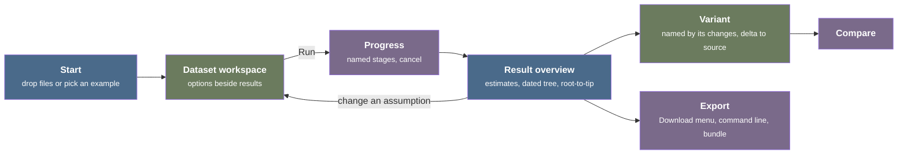

# App UI redesign and web2 platform audit

Date: 2026-11-12

The shared UI of the web and desktop apps ([packages/app-ui](../../packages/app-ui)) follows the CLI. The "New analysis" page shows the commands with their CLI names, every setting with its flag, and a permanent command-line panel, so it reads like the `--help` text of the commands. The results page shows every output of a run on one long page. Under the UI, the web app web2 ([packages/app-web2](../../packages/app-web2)) still carries parts of the hosted app that it replaced, and it loses every run when the tab reloads. This report records the current state with its evidence, the practice of established products, a target design for the UI and for the web2 platform under it, and the decisions that remain open.

Code references are at `b60cc5de8` of the `rust` branch. App observations are of the published web app v1.0.0 (https://treetime.neherlab.click) on 2026-11-12.

## Summary

- **The app is an analysis workbench.** Its loop is: bring a dataset, set a few scientific assumptions, run, read a dated tree with its diagnostics, change one assumption, compare, export. Statistics programs with the options beside the results (JASP, jamovi, Tempest), client-side tools that open dropped files (Nextclade Web, auspice.us, Delphy), and experiment trackers (Weights & Biases) support this loop. The current UI follows the form of a command-line tool, which fits the loop least
- **The load is measurable.** The first screen has 25 controls and 45 text blocks above the fold, and the first task needs 2 of them. The root-to-tip plot starts at about 1,700 px on a 900 px screen. On a phone, the Run button is at about 3,220 px of a 3,320 px page
- **Web2 loses work.** A reload, a crash of the back-end worker, or a closed tab loses every run and the files of the form. A run URL then shows a raw back-end error. No route deletes a run, and a large upload can stop the back-end worker
- **Recommended design**: a start screen with one drop zone and an example gallery; a dataset workspace with the options beside the results and a stale marker; results that open on an overview; variants linked to their source run; a command-line dialog on demand; one Download menu; runs that persist in the browser
- **Settings by purpose**: of the 73 entries of the time tree catalog, the 13 data-import entries become detected facts in the data section, the 22 output entries leave the form for the export, and the 33 analysis settings get two disclosure levels with search. CLI flags appear only in help, search, and the command dialog
- **Rust work comes first** for setting purposes, run names, the source run of a variant, a delete route, portable file names, the run bundle, and persisted runs, because the project keeps domain logic out of TypeScript
- **The hosted app can go**: `packages/app-web`, the `treetime-server` binary, the static-file router, the socket-only features of the router, the hosted branches of `app-ui`, three `dev/app` modes with their ports, and the docs and KB text about them
- **Defects found**: identical runs give different results, run titles in UTC, a prefilled outgroup that passes the checks and fails the run, a large upload that stops the back end, internal paths in the command line, and smaller text and comparison defects (see [Defects](#defects))
- **Open decisions**: the run model of web2, edits of three decision files, the name of the router crate, and five product and science texts (see [Open decisions](#open-decisions))

## Method

- **Code**: the routes, shell, analysis form, run page, and result views of `packages/app-ui/src`; the web2 entry and workers (`packages/app-web2`); the back end (`packages/app-backend`), the router (`packages/app-server`), and the WebAssembly bindings (`packages/app-wasm`); the setting catalog [packages/app-contracts/setting-catalog.json](../../packages/app-contracts/setting-catalog.json)
- **Published app** at 1440x900 and 390x844: the example `ebola/100`, a default time tree run, a second run with the skyline prior and confidence intervals, the comparison of the two, a reload, a new tab, and a browser check of every page of the deploy
- **Persona walkthrough** on the published app with three personas: a course student who has never used a CLI, a genomic epidemiologist who knows Nextstrain, and a CLI expert who uses `treetime` and `augur refine` in pipelines. Six tasks: a first dated tree from an example; the root date with its interval, the clock rate, the temporal signal, and the clock outliers; a rerun with the skyline prior and a clock filter, then a comparison; the command line and the downloads; the temporal signal only, on another dataset; a failure and its recovery. Per screen, the walkthrough counted the controls and text blocks above the fold and the scroll distance to the information that the task needs
- **Product survey**: 11 products, in live use and in their source where it is open: Nextclade Web, Auspice and auspice.us, Delphy, Taxonium, Microreact, Galaxy, W-IQ-TREE, NGPhylogeny.fr, Tempest, BEAUti, and the TreeTime 0.x web server ([kb/proposals/feat-inv-treetime-web-v0.md](../proposals/feat-inv-treetime-web-v0.md))
- **Guideline survey**: interaction guidelines (Nielsen Norman Group, GOV.UK, Carbon) and the documentation of products in other domains with the same loop: statistics programs, experiment trackers, cloud consoles, notebooks, editors
- **Independent critique** of the live app by a reviewer who had not seen the other findings
- **Platform audit**: a trace of every part of the hosted app that remains in the Rust crates, the TypeScript packages, the dev tooling, the docs, and the KB, and a study of browser storage for runs that persist

## What kind of app this is

The loop of the app: bring related files (a tree, an alignment, metadata with sample dates) or an example; choose a question (date the tree, check the clock signal, reconstruct ancestral sequences, tidy the tree); set a few scientific assumptions; compute for under a second (100 tips) to minutes (thousands of tips); read a main figure with its diagnostics; change one assumption; compare; export files for Nextstrain or a paper.

- **Statistics program** (JASP, jamovi; in phylogenetics, Tempest): analyses in a top bar, options in a left panel, results in a right panel. In JASP, a click on an earlier result "brings up the options that were used to generate that analysis" [[doc](https://jasp-stats.org/getting-started/)]. Tempest computes its root-to-tip plots again on each change of the rooting settings [[src](https://github.com/beast-dev/Tempest/blob/8e1cf064e3b5485a281aa1e39be15fda3f1977e0/src/tempest/TempestPanel.java#L311-L317)] and links the selection of the tree to the root-to-tip and residual plots [[src](https://github.com/beast-dev/Tempest/blob/8e1cf064e3b5485a281aa1e39be15fda3f1977e0/src/tempest/TempestPanel.java#L352-L367)]. This pattern fits configure-and-inspect best. A time tree run takes longer than the 1 s limit for an uninterrupted flow of thought [[doc](https://www.nngroup.com/articles/response-times-3-important-limits/)], so the app runs on request instead of on each change
- **Client-side drop-and-go tool** (Nextclade Web, auspice.us, Delphy, Taxonium): one drop zone that reads the dropped files, examples one or two clicks away, and a save file that opens again through the same drop zone (Delphy writes `.dphy` files [[src](https://github.com/fathominfo/delphy-web/blob/1a495287da64655e28b325728f3f00656a939792/src/ts/ui/customize/customizeui.ts#L304)]). Nextclade Web opens its example from a URL parameter [[src](https://github.com/nextstrain/nextclade/blob/6190424cf8014d999fccf59d049c2c78a8bc28bb/packages/nextclade-web/src/io/createInputFromUrlParamMaybe.ts#L28-L30)] and keeps the dataset selection across reloads [[src](https://github.com/nextstrain/nextclade/blob/6190424cf8014d999fccf59d049c2c78a8bc28bb/packages/nextclade-web/src/state/dataset.state.ts#L42-L46)]. This pattern fits the entry and the persistence of a web app without a server
- **Experiment tracker**: a run list with rename, pin, and delete, and a baseline run with deltas. Weights & Biases pins up to 20 runs and shows the deltas against one baseline in the runs table [[doc](https://docs.coreweave.com/models/runs/compare-runs)]. This pattern fits the history and the comparison
- **Interactive data viewer** (Auspice, Taxonium, Microreact): a large central view, linked panels, the view state in the URL [[src](https://github.com/nextstrain/auspice/blob/c3122c404328a89888a332d12f638a6ac28e2364/src/actions/recomputeReduxState.js#L54-L94)], and downloads of "the currently displayed view" [[src](https://github.com/nextstrain/auspice/blob/c3122c404328a89888a332d12f638a6ac28e2364/src/components/download/downloadButtons.js#L36-L44)]. This pattern fits the result view, which already embeds Auspice
- **Patterns that fit poorly**:
  - **Form of a command-line tool** (the IQ-TREE forms of Galaxy and W-IQ-TREE): every option of a command in one form. Galaxy serves thousands of tools to experts and still shows only 11 of the 116 inputs of its IQ-TREE form at first. The current TreeTime UI follows this pattern
  - **Wizard**: suits novices and infrequent tasks, but "the tedium of clicking through each of the steps can overwhelm the advantage" for repeated use [[doc](https://www.nngroup.com/articles/wizards/)]. TreeTime users run again with one change
  - **Live playground or reactive notebook** for the whole time tree: runs take too long, and a free run order creates hidden state. One part of the notebook pattern fits: the lazy mode of marimo "marks dependent cells as stale instead of running them" [[doc](https://docs.marimo.io/guides/expensive_notebooks/)], which is the stale marker of the target design

The target is a **dataset workspace** that combines the options beside the results (statistics program), the drop zone and the save file (drop-and-go tool), the history and the comparison (experiment tracker), and the result view (data viewer).

## Current state

### Screens

- **Shell** ([packages/app-ui/src/RootLayout.tsx](../../packages/app-ui/src/RootLayout.tsx)): a header with the search trigger, the docs link, and the theme toggle; a resizable sidebar with "New analysis", a run filter, a command filter, and the run list. Each run entry shows its status, its title, the command name, the first two changed flags as monospace badges, and a compare checkbox [packages/app-ui/src/shell/AppSidebar.tsx#L170-L227](../../packages/app-ui/src/shell/AppSidebar.tsx#L170-L227). Also a command palette and, on desktop, a "Runs folder" dialog
- **New analysis** (`/new`, [packages/app-ui/src/analysis/DraftForm.tsx](../../packages/app-ui/src/analysis/DraftForm.tsx)): numbered steps "01 Analysis" (five radio cards with the title, the CLI name, a description, and input badges), "02 Data" (three file rows with "Choose file" and "Example files", and the buttons "Example datasets" and "Example configs"), and "03 Settings" (a toggle between "Main settings" and "All 56 settings"). A sticky aside holds the Command panel (CLI and YAML, copy, "Load YAML") and the Checks panel with the Run button [packages/app-ui/src/analysis/DraftForm.tsx#L117-L139](../../packages/app-ui/src/analysis/DraftForm.tsx#L117-L139)
- **Main settings** of the time tree: 8 rows (clock rate, confidence intervals, coalescent prior, root, clock filter, polytomies, substitution model, iterations), each with the CLI flags as chips under the control
- **All settings**: the 56 settings in 12 groups that are the headings of `--help`. Each row has a label, the flag, "Default: ...", the help with "More", and the control. The groups without output paths open by default [packages/app-ui/src/analysis/SettingsPanel.tsx#L191](../../packages/app-ui/src/analysis/SettingsPanel.tsx#L191). The page is 4,808 px high, about five screens
- **Run page** (`/runs/$id/results|settings|log`, [packages/app-ui/src/runs/RunPage.tsx](../../packages/app-ui/src/runs/RunPage.tsx)): a header with the title, status, command, date, duration, version, a "Compare with..." select, Pin, and "Edit and run again"; tabs Results, Settings, Log
- **Time tree results**: a warnings alert; a summary strip of six equal cells (root date, clock rate, temporal signal, samples, coalescent prior, log likelihood); the embedded Auspice with its full sidebar (date range, color by, filter, five layouts, branch length, branch and tip labels, explode, entropy); the selection panel; the root-to-tip plot, beside the tree only from a container width of 100 rem [packages/app-ui/src/runs/TreeWorkspace.tsx#L50](../../packages/app-ui/src/runs/TreeWorkspace.tsx#L50); the skyline; the substitution model (frequency chart and rate matrix); the table of 10 output files with "Download all"; the citation [packages/app-ui/src/runs/RunPage.tsx#L187-L213](../../packages/app-ui/src/runs/RunPage.tsx#L187-L213). The page is 3,209 px high for 100 tips
- **Settings tab** of a run: the table of the settings that the run used, with internal upload paths, and a "Reproduce" panel with CLI and YAML
- **Log tab**: one collapsible card per stage, with line counts, warnings, and durations
- **Compare page** (`/compare/$a/$b`): a table of the estimates with differences, the root date intervals, the shift of each shared ancestor, and the settings that differ

### Platform

- **Web2** runs the shared UI on the Rust back end compiled to WebAssembly. The router runs in a back-end worker, and each run computes in a job worker of its own ([kb/decisions/app-web2-wasm-worker-back-end.md](../decisions/app-web2-wasm-worker-back-end.md)). The run files are JavaScript typed arrays of the in-memory file system of Emscripten, outside the 4 GiB WebAssembly memory. The linear memory holds the peaks of requests, such as upload bodies and the JSON of results
- **Desktop** runs the same UI on a native back end through N-API (`packages/app-napi`), with a runs folder on disk
- **Hosted app**: `packages/app-web` with the socket server `treetime-server` of `packages/app-server`. It has had no deploy since commit `e3b4161d6`, and `.github/workflows/web.yml` publishes only web2

## Problems

Grouped by screen. The defects of single behaviors are in [Defects](#defects).

### Entry and setup

- **A command before data.** Five cards with the CLI names (`timetree`, `clock`) take the top of the first screen [packages/app-ui/src/analysis/CommandCards.tsx#L64](../../packages/app-ui/src/analysis/CommandCards.tsx#L64). The surveyed tools start with data or an example: Taxonium reaches a first result in 1 click, Nextclade Web in 2, the TreeTime 0.x server in 3. TreeTime v1 needs 3 clicks and about 600 px of scrolling
- **A permanent command panel.** It shows an empty state ("The command appears when the settings are valid"), then a command with internal paths such as `/treetime/runs/<id>/inputs/<n>/tree.nwk` that exist nowhere for the user. No surveyed product keeps generated code beside a form; each shows it on request
- **CLI syntax on every control**: flag chips under each main setting, `--flag` and "Default: ..." on each row of All settings, CLI names on the cards, raw flags as badges in the run list
- **Settings grouped by the CLI.** The catalog takes the group of a setting from its `--help` heading [packages/app-backend/src/config/catalog.rs#L137-L139](../../packages/app-backend/src/config/catalog.rs#L137-L139). So the time tree form mixes data parsing (Newick dialect, metadata delimiters, date column, date format, alphabet, zero-based positions), analysis assumptions, and reproducibility, and shows 22 output entries under a fold, although the app sets the outputs of every run itself
- **Three example entry points**: "Example datasets" (a list of path names such as `dengue/1000` in an inner scroll box with 2.5 visible rows, sorted as text: `dengue/100`, `dengue/1000`, `dengue/20`), "Example configs", and an "Example files" button per file row. No entry shows the organism, the sample count, or the date range; the TreeTime 0.x server listed them. After loading, the dataset name appears nowhere
- **The Run button lives in the aside.** When the layout stacks to one column, the button follows all three steps and the command panel
- **Hidden carry-over**: "New analysis" reopens the previous draft, including the changed settings of an "Edit and run again". "Reset form" acts at once, with no confirmation and no undo, and keeps the uploads of the pending run ([kb/issues/N-app-reset-form-keeps-uploads-of-the-pending-run.md](../issues/N-app-reset-form-keeps-uploads-of-the-pending-run.md))
- **Setting texts in TypeScript.** The list of main settings comes from Rust (`fn main_settings()` [packages/app-backend/src/command.rs#L98](../../packages/app-backend/src/command.rs#L98)), but the rows that join several settings, their labels, and their option texts are TypeScript constants (`CHOICE_TEXT`, `TOPOLOGY_SWITCHES`, and the key lists of [packages/app-ui/src/analysis/MainSettings.tsx#L43-L90](../../packages/app-ui/src/analysis/MainSettings.tsx#L43-L90)). The project keeps CLI knowledge in the Rust catalog
- **CLI words on the novice path**: the check "--sequence-length is required without an alignment" while the alignment slot says "recommended"; the option label `opt`; "Not set uses the command default" without the default

### Results

- **One long page holds every output**: summary, tree with all viewer controls, selection, root-to-tip, skyline, substitution model, 10 files, citation. Exploration, diagnostics, model details, and file management compete. Above the fold are 22 controls and 41 text blocks; the task needs the 4 estimate cells
- **Linked evidence is far apart.** At 1440 px the root-to-tip plot is below the tree and a 300 px entropy panel, at about 1,680 px
- **The summary strip gives unlike facts equal weight**: estimates (root date, rate), diagnostics (correlation, samples), model choices (coalescent prior), and execution facts (log likelihood) are equal cells [packages/app-ui/src/runs/TimetreeResultsView.tsx#L119-L143](../../packages/app-ui/src/runs/TimetreeResultsView.tsx#L119-L143)
- **The embedded Auspice brings a second application**: its full sidebar of controls opens by default inside the app shell
- **A long warning block opens the results** before the estimates, with the sample names inline. On a phone it fills the first screen
- **The root date interval needs a second run**: confidence intervals are off by default, and "No interval computed" offers no action
- **Clock outliers only in tooltips**: the results have no outlier list, and one count mixes undated samples and outliers
- **Two compare entry points**: the checkboxes of the run list and the "Compare with..." select of the run header [packages/app-ui/src/runs/RunPage.tsx#L344](../../packages/app-ui/src/runs/RunPage.tsx#L344)
- **Weak states**: the selected option of a segmented control differs from the others only by a lighter background (oklch 0.28 against transparent), and the disabled Run button looks active (blue)

### History and continuity

- **Runs are named by a timestamp** ("Run 2026-11-12 05:35", [packages/app-backend/src/runs/store.rs#L71](../../packages/app-backend/src/runs/store.rs#L71)). Two runs of one minute have the same name in the list and on the compare page
- **A reload loses every run and the files of the form.** The run store lives in the memory of the back-end worker. The draft in `sessionStorage` keeps the upload paths of the lost back end, so every reload with files shows "Some input files are no longer available". Examples enter the draft as uploads ([packages/app-ui/src/analysis/useExampleData.ts#L158](../../packages/app-ui/src/analysis/useExampleData.ts#L158)), so they cannot be fetched again either
- **A run URL without a run** (after a reload, in a new tab, after a Ctrl+click on a sidebar run, or after Back) shows "The run cannot be loaded: no run with id ..." while the sidebar says "No runs yet". In a background tab the page waits 25 s or more on "Loading the run", because the query retry pauses while the document is hidden
- **Variants are not linked to their source.** "Edit and run again" creates an unrelated run. The draft knows its source (`from_run_id`), but the run record has no source field ([packages/app-backend/src/runs/record.rs](../../packages/app-backend/src/runs/record.rs))
- **No crash notice.** When the back-end worker stops, `PortClient.stop()` [packages/app-ui/src/port-fetch.ts#L213](../../packages/app-ui/src/port-fetch.ts#L213) fails the open requests and nothing shows the stop ([kb/issues/M-web2-wasm-panic-loses-the-back-end-state.md](../issues/M-web2-wasm-panic-loses-the-back-end-state.md)). The decision file of web2 states that this notice exists
- **The page reloads by itself** after an error while loading a code chunk (`reloadOnChunkError()`, [packages/app-ui/src/chunk-reload.ts](../../packages/app-ui/src/chunk-reload.ts)), which loses every run of the tab. This is rare in production, because the publish script keeps old assets
- **No leave warning**: no `beforeunload` guard exists
- **The `jobs` URL parameter is lost** at the first redirect ([kb/issues/N-web2-jobs-parameter-lost-after-navigation.md](../issues/N-web2-jobs-parameter-lost-after-navigation.md)), and the thread count of the back end appears only in the console

### Reproducibility and export

- **Internal paths in the command line, the YAML, the run settings, the outputs, and the errors.** Uploads are configured as `/treetime/runs/<id>/inputs/<n>/<name>` [packages/app-backend/src/runs/manager.rs#L307-L309](../../packages/app-backend/src/runs/manager.rs#L307-L309), and `fn config_code()` [packages/app-backend/src/config/code.rs#L24](../../packages/app-backend/src/config/code.rs#L24) prints them. The same paths reach `input_tree` and `alignments` of `timetree.node-data.json`, the alignment paths of `*.model.json`, and error texts. A command that the user copies from web2 runs nowhere
- **The run archive cannot reproduce or reopen a run.** `fn write_run_zip()` ([packages/app-backend/src/runs/files.rs](../../packages/app-backend/src/runs/files.rs)) packs only `out/`, with no record, events, inputs, or `run.yaml`
- **Two download places**: the Auspice menu with "the tree in view", and the file table at about 2,850 px. Neither names the dated tree, and every file is `timetree.*`, so the downloads of different runs collide
- **Server words in user-facing text**: the 413 description "upload limit of the server" [packages/app-server/src/routes.rs#L173](../../packages/app-server/src/routes.rs#L173), "the directories the server reads inputs from" [packages/app-server/src/confine.rs#L86](../../packages/app-server/src/confine.rs#L86), the doc of `UiDraftOrigin::Upload` "A file uploaded to the server" [packages/app-backend/src/app_settings/settings.rs#L185](../../packages/app-backend/src/app_settings/settings.rs#L185), "previous server" in the description of `/api/events` [packages/app-server/src/routes.rs#L309-L310](../../packages/app-server/src/routes.rs#L309-L310), and the inputs note, which omits the crash case

### Phone

- The five cards fill the first screen and a half; the Run button is at about 3,220 px of 3,320 px and is not sticky; the data rows overflow (scroll width 440 px at 390 px); the warning block fills the first screen of the results

## Strengths to keep

- **Checks in Rust** before the run, with the duplicate-run notice
- **Parsed input facts** under each file ("100 tips, 98 internal nodes", "100 rows; ID column name; date column date")
- **Linked selection** between the tree, the selection panel, and the root-to-tip plot
- **The staged log** with warning counts and durations, and the compare page with estimate differences and the shifts of shared ancestors
- **The neutral design language** (`packages/design`, [docs/en/development/design-language.mdx](../../docs/en/development/design-language.mdx)), keyboard shortcuts, and the command palette

## Requirements

The origin of each requirement is in parentheses: the goal of the redesign, a guideline, product practice, or the platform.

- **A first result in at most 3 actions** from the first screen with an example (product practice: Taxonium 1, Nextclade Web 2, TreeTime 0.x 3)
- **No CLI syntax on the routine path**; flags only in help, search, and the command dialog (goal)
- **At most two disclosure levels** for settings: the frequent settings first, the rest behind one clearly labeled control. "Designs that go beyond 2 disclosure levels typically have low usability" [[doc](https://www.nngroup.com/articles/progressive-disclosure/)] (guideline: progressive disclosure [1](#gloss-1))
- **Changed settings stay findable**: a changed marker, a "changed only" filter, and a reset per setting, as the settings editor of VS Code does with its "Commonly Used" group, the `@modified` filter, and "Reset Setting" [[doc](https://code.visualstudio.com/docs/configure/settings)] (product practice)
- **Help that the task needs stays visible**: "Don't use tooltips for information that is vital to task completion" [[doc](https://www.nngroup.com/articles/tooltip-guidelines/)] (guideline)
- **Overview first, zoom and filter, then details on demand**, with history and extraction of data [Shneiderman 1996](https://doi.org/10.1109/VL.1996.545307) [[1](#ref-1)] (guideline)
- **The main estimate gets the largest area and the highest contrast**, with sensible precision: "Displaying excessive detail or precision" is one of the common pitfalls of dashboard design [[doc](https://www.perceptualedge.com/articles/Whitepapers/Common_Pitfalls.pdf)] (guideline)
- **Generated code on request**, attached to the draft or to the finished run, in several formats with copy: the "Equivalent code" of the Google Cloud console [[doc](https://docs.cloud.google.com/compute/docs/instances/create-start-instance)], and W-IQ-TREE, which gives "a command line showing the user-specifications" so the run can be repeated on a local computer [Trifinopoulos et al. 2016](https://doi.org/10.1093/nar/gkw256) [[2](#ref-2)] (product practice)
- **Every URL and list entry that the UI shows opens again after a reload** (platform)
- **Progress names the stage**; past 10 s it shows when the work will end [[doc](https://www.nngroup.com/articles/progress-indicators/)] and a way to stop it (guideline). Nextclade Web [[src](https://github.com/nextstrain/nextclade/blob/6190424cf8014d999fccf59d049c2c78a8bc28bb/packages/nextclade-web/src/components/Results/ResultsStatus.tsx#L122-L185)] and Delphy [[src](https://github.com/fathominfo/delphy-web/blob/1a495287da64655e28b325728f3f00656a939792/src/ts/ui/uploadui.ts#L158-L183)] name each stage of their work
- **The browser store is not the only copy**: export and import of a run bundle, because browsers may clear script-writable storage [[doc](https://web.dev/articles/storage-for-the-web)] (platform)
- **Errors name the affected records and sit where the user acts**, with a summary of the checks before Run, as the GOV.UK pattern puts an error summary at the top and each error message next to its field [[doc](https://design-system.service.gov.uk/patterns/validation/)] (guideline)
- **The design language stays**: grays, one blue accent, IBM Plex Sans, and data colors apart from interface colors (platform)
- **Domain logic stays in Rust**: setting purposes, run names, change summaries, and previews come from Rust operations or the catalog (platform)

## Target design

### Journey

### Screens

- **Start screen** at `/`, which today redirects to `/new`:
  - One drop zone for all input files. Rust detects the type of each file by its content (tree, alignment, metadata, YAML configuration, run bundle) and reports a file that it cannot place
  - An example gallery: one card per dataset with the organism and segment, the sample count, the date range, the sequence length, and one "Open" action. The facts come from `data/index.json`, which Rust generates
  - The line "Your files stay in this browser. Nothing is uploaded." on web2
  - Recent work: the latest run groups
- **Dataset workspace**:
  - **Options panel** on the left, resizable: the analysis selector, the data section, the key assumptions, "All settings", and a pinned footer with the summary of the checks and the Run button (Ctrl+Enter)
  - **Main area**: the results of the shown run, or before the first run a preview of the data: the tree without dates, the input facts, and the clock preview
  - **Stale marker** [2](#gloss-2): when the options differ from the shown run, a bar above the results reads "Settings changed since this run: coalescent prior, confidence. Run to update." with Run and "Revert to this run's settings"
  - **A click on a run in the history** shows its results and loads its options into the panel, read-only until the user edits them, as in JASP
- **Run history** in the left sidebar, collapsible: grouped by derivation, one group per line of work with each variant [3](#gloss-3) under its source run. Each entry shows the run name, the status, the headline estimate, and a menu (rename, pin, compare with source, export bundle, delete). A storage meter sits at its foot
- **Compare** (`/compare/$a/$b`) stays. It opens from the history (select two runs) and from "Compare with source" on a variant, and it compares runs of the same analysis, or warns

### Settings model

The catalog of a command splits by purpose. The counts are for the time tree, whose catalog has 73 entries: 56 that the form shows today and 17 output paths.

- **Data import** (13: the three file slots, partitions, Newick dialect, missing sequences, metadata ID columns, metadata delimiters, date column, date format, sequence length, alphabet, zero-based positions): shown as detected facts in the data section, each with "Change" that opens its override, for example "Dates: column `date`, 100 of 100 read as YYYY-MM-DD. Change". Tempest and Microreact also ask for the ID and date columns at import
- **Analysis assumptions** (33: molecular clock, rooting, dating, coalescent prior, polytomies, branch lengths, substitution model, ancestral reconstruction). Level 1 shows the key assumptions in plain words with their effective value, for example "Automatic: least-squares rerooting" from Rust in place of "Not set". Level 2, "All settings", shows the rest grouped by purpose, with search (also by flag), a changed filter, a changed marker, and a reset per setting
- **Outputs** (22: the 17 output paths and 5 output options): leave the form. The app already writes every output (`--output-all`), and the export chooses what to download. The divergence units and the Newick annotations become export options
- **Tree ordering** (4) and **seed** (1): under All settings, in the group "Reproducibility and ordering"
- **CLI flags**: in the help of each setting ("Command line: `--clock-filter 4`"), in search, and in the command dialog only
- **Purposes come from Rust**: the catalog gets a purpose per setting (data, analysis, output, ordering), and the texts of the main-setting rows move from TypeScript into the catalog

### Results model

- **Run header**: the run name (rename inline), status, analysis, dataset, date; the actions Download (menu), Command line, "Create variant", and a menu with pin, export bundle, and delete
- **Warnings**: one line under the header ("3 warnings: 3 tips dated outside their input date range. Show"), and each warning also beside the estimate that it affects, as the Samples estimate already does
- **Overview**, the default view of a time tree: an estimates panel with hierarchy (root date with its interval and clock rate with its standard deviation large; temporal signal and samples used smaller; coalescent prior, log likelihood, iterations, and duration in the run details), the dated tree as the largest element, and the root-to-tip plot linked beside it at desktop widths. The selection details open in a side panel
- **Views by purpose**, as tabs under the header: Clock (root-to-tip, residuals, outlier table), Population (skyline, coalescent settings), Model (substitution model, entropy), Log, Settings (the effective settings of the run, changed only by default). Each view exports its own data
- **Viewer controls**: a compact toolbar over the tree (color by, layout, search, zoom to root), and "View options" for the full Auspice sidebar
- **Per analysis**: the clock analysis opens on the root-to-tip plot with the tree beside it; the ancestral analysis opens on the tree colored by mutations with a mutations table; optimize and prune open on the tree with statistics before and after

### Iteration and comparison

- **"Create variant"** opens the options of the source run in the workspace with a summary of the changes that grows while the user edits. Run creates a run linked to its source
- **Run names** from the dataset, the analysis, and the changed assumptions, built in Rust from the changed settings of the record: "ebola/100, time tree: skyline, confidence"
- **Delta to the source** on the overview of a variant: one line of estimate deltas ("Root date -46 d, clock rate -7.9 % against the source") with a link to the full comparison
- **Baseline**: optional; a run pinned as the baseline shows deltas in the history entries

### Reproducibility and export

- **Download menu** in the run header: Auspice JSON, dated Newick, Nexus, "All files (.zip)", and "All files...", a dialog with the file list and a description per file. File names carry the run name, and the dated tree is labeled "Dated tree (Newick, branch lengths in years)"
- **Command line dialog** on the draft and on each run: CLI and YAML with portable paths (`inputs/aln.fasta`, a numbered folder only when two inputs share a name), copy, a methods paragraph, and the citation
- **Run bundle [4](#gloss-4)**: export from the run menu, import through the drop zone of the start screen. The command line of the dialog runs unchanged inside an extracted bundle
- **Settings from elsewhere**: "Apply settings from a run" and "Load config (YAML)" in the menu of the options panel replace the "Example configs" button and the "Load YAML" fold

### States

- **Empty**: the start screen
- **Running**: the named stages in the main area with a cancel action; the options stay editable for the next run
- **Failed run**: the error with its causes and the affected samples, the log stages, and "Edit and run again". The form opens at the faulty setting with focus
- **Stale**: the stale marker
- **Back-end crash**: a persistent banner at the top of the main area, not a toast, with the first error line and its effect in words. After a crash the worker restarts by itself, so the banner offers only dismiss; after a failed start no back end runs, so the banner offers "Reload the page"
- **Missing run**: an empty state "This run is not in this browser" with one line of cause and the actions "Open the run list" and "Import a run bundle", never the raw back-end text
- **Storage full**: the quota error names the size needed and offers to remove the oldest runs that are not pinned
- **Leaving the page**: a warning while a run computes, an import is open, or the form holds files that no run uses

### Visual rules

- **One emphasis per region**: the tree is the largest element of a result; the Run button is the one primary button of the workspace
- **Monospace only for file names, values that users copy, and code**: no flag chips, no CLI command names on routine controls
- **No numbered step markers**: the workspace is not a sequence
- **Fewer boxes**: sections apart by space and one rule; cards only where a border groups content
- **Tabular numbers and sensible digits** for estimates: "7.6e-4 per site per year, ± 4.1e-5"
- **Clear states**: the selected option of a segmented control takes the accent; a disabled button looks disabled
- **Phone**: the options panel becomes a sheet, the Run button stays in a bottom bar, the overview stacks with the tree at full width, and data rows wrap

## Decision axes

Each axis is independent unless a coupling is named. The recommended option of each axis comes first.

### Layout

- **Dataset workspace, options beside the results** (recommended)
  - (+) The user changes an assumption while the result that motivated the change stays in view
  - (+) A click in the history restores the options and the results of a run together
  - (-) A new layout for the analysis routes; phone sizes need an arrangement of their own
- **Page flow** (today, restyled): start, setup page, results page
  - (+) The smallest change of routes and components
  - (-) Setup and results never share the screen, so each rerun leaves the evidence that motivated it
- **Wizard**
  - (+) Guides first-time users
  - (-) Tedious for reruns, the main use

### Entry

- **Start screen with one drop zone and an example gallery** (recommended)
  - (+) A first result in 2 actions with an example (Open, Run), or 1 when an example opens as a finished run
  - (+) Detection of the file type removes the choice of a slot
  - (-) The detection by content must live in Rust and must report files that it cannot place
- **Command choice first** (today)
  - (-) The user meets five CLI names before any data

### Analysis choice

- **Compact selector in the options panel, labeled by question** (recommended): "Date the tree" (time tree, preselected), "Check the clock signal" (clock), "Reconstruct sequences" (ancestral), and "Tree tools" (optimize, prune) in a smaller group
  - (+) One line in place of five cards; the description shows once, for the selected analysis
  - (=) The command name stays in the command dialog and in search
  - (-) The four questions need approved wording
- **Cards** (today)
  - (-) They take the first screen and put CLI names on routine controls

### Settings disclosure

- **Two levels with search** (recommended): key assumptions first, then "All settings" by purpose with search, changed filter, changed marker, and reset
  - (+) Matches the two-level limit and the VS Code settings editor
  - (+) A "Changed: 2" summary keeps changed settings visible at level 1
  - (-) The key settings of each command are a product decision
- **Main and All as two views** (today)
  - (-) Two routes to one setting, with different controls in each
- **Presets first**
  - (-) Needs scientifically approved recipes (see Presets)

### Data-import settings

- **Detected facts with overrides in the data section** (recommended)
  - (+) 13 entries leave the analysis list, and most users never open them
  - (+) The facts that the user must check, such as the date column and the count of dates read, are in view
  - (-) The input facts operation must report what it detected for each override
- **An "Input data" group** (today)
  - (-) Parsing options look like analysis assumptions

### Clock preview

- **Root-to-tip preview in the workspace** before and between runs (recommended), computed by Rust when data loads and when rooting or the clock filter changes, below a size limit; above the limit, an "Update preview" button
  - (+) The temporal signal, the outliers, and the effect of rooting show before the first time tree run, as in Tempest and the clock layout of Auspice
  - (+) The separate clock analysis stays for its outputs
  - (-) Needs a Rust preview operation that writes no run record, and a size limit measured on the example datasets
- **No preview** (today)
  - (-) The temporal signal shows only after a run

### Run trigger

- **Explicit Run with a stale marker** (recommended); examples may open as finished runs
  - (+) No surprise computation on large data, and results never silently mismatch the options
  - (+) An example as a finished run gives a first result in 1 action
  - (-) Bundled example runs must be generated again when the outputs change, or computed on open
- **Run on every change**
  - (-) Minutes on large data, and each change adds a run to the history

### Results structure

- **Overview plus views by purpose** (recommended)
  - (+) The overview answers the main question on one screen, and the details stay one click away
  - (+) Each view gets its space and its own export
  - (-) Selection and filter state must persist across the views
- **One long report with collapsible sections**
  - (+) Prints as one document
  - (-) Keeps exploration, diagnostics, and files in one scroll
- **Today's page**
  - (-) The problems under Results

### Viewer controls

- **Compact toolbar plus "View options"** (recommended)
  - (+) The tree gets the width, and the common actions stay one click away
  - (-) The toolbar must stay in step with the Auspice controls that TreeTime patches ([kb/issues/N-app-ui-auspice-sidebar-controls-patch-upstream.md](../issues/N-app-ui-auspice-sidebar-controls-patch-upstream.md))
- **Full sidebar open** (today)
  - (+) Familiar to Nextstrain users
  - (-) A second application inside the first

### Iteration

- **Variants linked to their source** (recommended), named by their changes, with a delta line and "Compare with source"; one compare entry in the history
  - (+) The question of each run is its name, and the answer is one line
  - (-) Needs the source run in the record and run names built in Rust
- **Unlinked reruns** (today)
  - (-) Equal timestamp names, and the user reconstructs the relations

### Command line

- **Dialog on request** (recommended) on the draft and on each run, with portable paths, a methods paragraph, and the citation
  - (+) The surveyed products do this, and the form gains a 25 rem column
  - (-) Experts lose the live view of the command while they edit; a keyboard shortcut keeps it one action away
- **Permanent panel** (today)
  - (-) No surveyed product keeps one, and it shows internal paths

### Downloads

- **Download menu with the main formats and an "All files" dialog** (recommended)
  - (+) The common exports are one click away from every view, and the file descriptions stay
  - (-) The main formats per analysis are a product choice
- **File table at the end of the results** (today)
  - (-) Below three screens of other content

### Run names

- **Name built in Rust from dataset, analysis, and changed assumptions**, editable (recommended)
  - (+) Distinct names without typing
  - (-) Long change lists need a rule to shorten them ("skyline, confidence +2")
- **Timestamp** (today)
  - (-) Equal names within one minute

### Phone sizes

- **Desktop first, with a phone layout that keeps every function** (recommended)
  - (+) The main users work at desks with files, and course users on tablets still get every function
  - (-) Phone layouts need their own checks
- **Equal design for phones**
  - (-) High cost for a rare use with alignment files

### Presets

- **No preset gallery now**; "Apply settings from a run" and "Load config (YAML)" cover saved recipes (recommended)
  - (+) No scientific recipes to approve, and existing configurations stay usable
  - (-) First-time users do not see recipes such as the defaults of `augur refine`
- **Named presets with one recommended default**
  - (+) One click for common recipes
  - (-) Each preset is a scientific default that the team must approve and maintain

### Recommended combination

Dataset workspace, start screen with drop zone and gallery, question selector, two disclosure levels with search, detected data facts, clock preview, explicit Run with stale marker, overview plus views, compact viewer toolbar, linked variants, command dialog, Download menu, Rust-built run names, desktop-first phone layout, no presets now, and persisted runs (next section). Together they replace a CLI help page and a dump of outputs with one loop: open a dataset, see its clock signal, run, read the answer, change one assumption, read the difference, export.

## Run model of web2

The run history, the variants, and every run URL of the target design keep their meaning only if runs outlive the tab. Two models exist.

- **Runs that persist in the browser** (recommended). The back-end worker mirrors the run store into the origin private file system [5](#gloss-5) and keeps the record pointers in IndexedDB. The Rust store keeps its file layout
  - **Ownership by mutability**: a finished run does not change, so every tab opens it read-only, loaded on open by the same Rust operation as the bundle import. A running run belongs to the tab that started it, through a lock of the Web Locks API [6](#gloss-6); another tab shows "Running in another tab" and refreshes when the run ends. Rename, pin, and delete take the lock of the run for the write and tell the other tabs through a `BroadcastChannel`. A run with the status running and a free lock was interrupted
  - **Recovery must change**: `RunManager::open()` [packages/app-backend/src/runs/manager.rs#L52](../../packages/app-backend/src/runs/manager.rs#L52) marks every stored running run as interrupted (`fn recover_interrupted()` [packages/app-backend/src/runs/store.rs#L146](../../packages/app-backend/src/runs/store.rs#L146)), which is wrong while another tab owns a live run. The back-end worker decides from the locks which runs were interrupted, and Rust marks only those
  - **The draft survives**: the store also keeps the upload run of the draft, so a reload keeps the files of the form. `fn remove_unstarted()` [packages/app-backend/src/runs/store.rs#L133-L144](../../packages/app-backend/src/runs/store.rs#L133-L144) must then spare an upload run that a draft references
  - **Memory**: loading on open bounds the memory of a tab by the runs that it opens, if the tab also unloads runs that are no longer in view
  - (+) Run URLs, the run list, pin, and reruns keep their meaning after a reload and in a new tab, and the UI has one run semantics with desktop
  - (-) Costs on top of the other model: the mirror with committed file generations and recovery, a state "stored, not loaded" for the run list, quota errors, a storage meter with the `navigator.storage.persist()` state, and cleanup
  - (-) Browsers may clear the store. Storage that is not persistent is "best effort" and the browser may clear it [[doc](https://web.dev/articles/storage-for-the-web)]. Safari deletes the script-writable storage of a site "after seven days of Safari use without user interaction on the site", except for web apps on the Home Screen [[doc](https://webkit.org/blog/10218/full-third-party-cookie-blocking-and-more/)], and its storage policy covers the File System API [[doc](https://webkit.org/blog/14403/updates-to-storage-policy/)]. The exported run bundle stays the only durable copy
  - (=) WasmFS with its OPFS back end would also take the files out of tab memory, but it needs Asyncify or JSPI in the single-threaded module and is untested with the wasm-bindgen output; the JavaScript mirror avoids that risk
- **Runs that live in the tab**: the app warns before leaving while the tab holds runs, explains a run URL without a run, offers bundle export and import, and shows the crash banner
  - (+) The smallest change: the fixes of the next section, which the other model needs too
  - (-) A reload, a closed tab, a crash, or a mobile browser that ends the tab loses every run. `beforeunload` "is not reliably fired, especially on mobile platforms" [[doc](https://developer.mozilla.org/en-US/docs/Web/API/Window/beforeunload_event)] and does not fire on a crash
  - (-) The shared UI gets two run semantics: a durable history on desktop and a list of the tab on web2, so the history grouped by derivation shows only the runs of one tab

## Platform fixes that both run models need

### Data loss and crashes

- **Large uploads**: `Backend.fetch()` takes the body as `Option<Vec<u8>>` [packages/app-wasm/src/backend.rs#L37-L44](../../packages/app-wasm/src/backend.rs#L37-L44), `read_body_blocking()` reads it in full on wasm [packages/app-server/src/api/blocking.rs#L28-L36](../../packages/app-server/src/api/blocking.rs#L28-L36), and only then does `store_upload()` compare it with the limit [packages/app-backend/src/runs/manager.rs#L263-L299](../../packages/app-backend/src/runs/manager.rs#L263-L299). The page reads the whole body first too (`request.arrayBuffer()`, [packages/app-ui/src/port-fetch.ts#L37](../../packages/app-ui/src/port-fetch.ts#L37)) and checks no size. A body of about 2 GiB or more cannot be allocated in `wasm32`, and the failed allocation stops the back-end worker and loses every run of the tab. Fix along the whole path: the page posts the `File` to the worker (a structured clone of a `Blob` passes a reference, not the bytes), the worker reads it in slices, and the exchange feeds the slices to the atomic upload writer, as downloads already stream. The page checks the size first against the limit that remains for the run, which counts every retained input of the run [packages/app-backend/src/runs/manager.rs#L278](../../packages/app-backend/src/runs/manager.rs#L278)
- **Crash banner** with the wording of the States section, and a reset of the queries
- **Chunk-load errors**: while runs exist or a run computes, show a notice with a reload button in place of the automatic reload
- **Leave warning** as in the States section

### Run lifecycle

- **Delete route**: no route, `RunManager`, or `RunStore` method deletes a run, on web2 or on desktop. A run does not own all its inputs: "Edit and run again" keeps the input paths of the source run (`fn rerunDraft()` [packages/app-ui/src/settings/rerun.ts#L12-L20](../../packages/app-ui/src/settings/rerun.ts#L12-L20)), so a removed run folder breaks every rerun that reads from it. Fix: inputs move into a store keyed by content (the record already holds the `sha256` of each input, [packages/app-backend/src/runs/record.rs#L91](../../packages/app-backend/src/runs/record.rs#L91)) that runs reference. `DELETE /api/runs/{id}` in the shared router refuses or cancels a computing run, removes the run and its references, removes the inputs that no run references any more, and emits a removal event. The UI hides the run at once and sends the delete when its Undo toast closes
- **Abandoned upload runs**: `remove_unstarted()` runs only in `RunManager::open()`, once per tab in web2. The form releases its upload run when the user discards the draft or replaces its files, after the uploads and the start in flight have ended, through the delete route
- **Run bundle**: one format with the record, the events, every input that the configuration of the run references (also inputs outside the run folder, which desktop records as real paths, and the files of input templates), and the outputs, all under the portable layout. One Rust import operation checks paths, sizes, and references, assigns a new id on a collision, and publishes only a complete run. Desktop shares it
- **The saved form after a reload**: the draft keeps the example path as its source and fetches the example again after a reload, and the toast names the reload as the cause
- **Run URLs without a run**: the empty state of the States section
- **Clade lookup**: the rule stays: a match is a node of another finished time tree run with the same set of samples below it (`fn clade_in_trees()` [packages/app-backend/src/results/clades.rs#L139](../../packages/app-backend/src/results/clades.rs#L139)), because sensitivity analyses change inputs (corrected dates, masked alignments, added outgroups) and the match keeps its meaning across them. With persisted runs, a sample-set index in Rust bounds the cost: each finished time tree run records its sample names, and the lookup loads only the runs that contain every sample of the clade. Today `fn clade_in_runs()` [packages/app-backend/src/results/clades.rs#L35-L60](../../packages/app-backend/src/results/clades.rs#L35-L60) reads every finished time tree run and holds all their trees together; the lookup should read one tree at a time

### Text and paths

- **Portable paths**: the run layer maps each upload path to a portable path, the file name under `inputs/` with a numbered folder only when two inputs share a name (two uploads of one name are valid, each in its own folder, [packages/app-backend/src/runs/manager.rs#L279](../../packages/app-backend/src/runs/manager.rs#L279)), and keeps the display name apart. `config_code()`, the bundle, and the provenance in the outputs all use this layout. Desktop gets an empty map and keeps its real paths
- **Server words**: reword the texts of the Reproducibility and export section; the confinement error becomes "is not a file uploaded to TreeTime"
- **Times**: the record keeps only UTC, and the UI formats every time in the zone of the browser
- **Thread count**: the log of a run names the WebAssembly module and the thread count

### Shared code that works against desktop

- **Request timeout**: `with_request_timeout()` (`packages/app-server/src/api/timeout.rs`, native builds) drops the handler future, but `run_blocking()` uses `spawn_blocking` [packages/app-server/src/api/blocking.rs#L38-L45](../../packages/app-server/src/api/blocking.rs#L38-L45), so the work continues while the desktop UI reports "took longer than 120 seconds". No socket needs this protection any more. Remove it with `ErrorCode::Timeout` and the split into `timed_routes()` and `api_routes()`
- **Route tests**: the test helpers build on `create_router()` of the hosted app, and the local helpers test the desktop settings routes under the input and limit policies of the server, while desktop uses other policies (`packages/app-napi/src/backend.rs#L52-L57`). The helpers should build the routers that the clients get: `api_router()` for the public routes, `local_api_routers()` with the desktop service for the local ones

### Dev tooling

- **web2 dev server**: `up_web2()` in `dev/app` only starts Vite, so the health probe, the commit check, and the HTTPS route request have no web2 target. They move from `up` to `up-web2`

## Removal of the hosted app

### Rust

- **`treetime-server` binary** (`packages/app-server/src/bin/treetime-server.rs`) with its flags, environment variables, jemalloc allocator, and inline tests, and its `[[production]]` entry in `.config/hawk.toml`
- **`web.rs`**: `create_router()`, `WebOptions`, static files, cache headers, compression, `check_host()` with `AllowedHosts`, security headers, and `pub mod web`; `test_web.rs` except the panic test, which moves to a route test file
- **The renderer branch of `api_router()`** ([packages/app-server/src/routes.rs#L60-L64](../../packages/app-server/src/routes.rs#L60-L64)), which only test helpers take
- **`ServerConfig.shutdown`** with `until_shutdown()` and its test: only the binary cancels the token
- **`RunLimits::Server`** with `check_server_limit()`, `ServerConfig.max_grid_points`, and their tests
- **Socket-only features**: the keep-alive of server-sent events, ETag revalidation (no client sends `If-None-Match`) with `AppState.instance`, `/api/health` with `HealthStatus`, `/api/openapi.json` with `AppState.openapi`, and the request timeout above
- **Cargo entries**: the jemalloc block of `packages/app-server/Cargo.toml`, the axum features `http1` and `tokio`, tokio `full` narrowed to what the router needs natively, the `tower-http` features `compression-gzip` and `compression-zstd`, and the stale "dev server" text of the `dev-opt` profile

### TypeScript

- **`packages/app-web`** with its workspace entry, the `build:web` script, its `bun.lock` entries, and its entries in `.config/knip.json`, `tsconfig.json`, and `oxlint.config.ts`. The Tailwind lint setting `tailwind.cwd` moves to `packages/app-web2`, whose `src/index.css` is identical, or the lint breaks
- **Hosted branches of `app-ui`**: the server text of `inputsNote()` ([packages/app-ui/src/analysis/InputsSection.tsx#L69](../../packages/app-ui/src/analysis/InputsSection.tsx#L69)), the URL branch of `saveRunOutput()` ([packages/app-ui/src/runs/saveRunOutput.ts#L57-L63](../../packages/app-ui/src/runs/saveRunOutput.ts#L57-L63)), `requestUrl()` (`packages/app-ui/src/api/keys.ts`), and their tests
- **`BrowserBackend` and `TAB_BACKEND`** (`packages/app-ui/src/browser-backend.ts`) and the `browserBackend` prop of `App`: with one web mode, `host === null` names it

### Dev, CI, docs

- **`dev/app` modes** `up`, `serve`, `health` and their helpers, with `status` reduced to the remaining servers; the justfile recipes `up`, `serve`, `health`, `build-web`, and the `build-web:prod` example of `dev/run-checks`
- **Ports**: the offsets `api`, `web`, and `serve` of `dev/lib/ports.sh`, the forwarding of `TREETIME_API_PORT`, `TREETIME_WEB_PORT`, and `TREETIME_SERVE_PORT` in `dev/docker/run`, and their tests; the docs that cite fixed ports change with them
- **Docs**: [docs/en/development/web-app.md](../../docs/en/development/web-app.md) goes, after its port-slot paragraph and the browser storage keys move to [docs/en/development/web2-app.md](../../docs/en/development/web2-app.md); the router text of `web2-app.md`, and the hosted-app text of `index.md`, `apps.md`, `desktop-app.md`, and `performance.md` change

### KB

- **Delete** [kb/issues/N-app-malformed-last-event-id-ignored.md](../issues/N-app-malformed-last-event-id-ignored.md) with its entry in [kb/TRIAGE.md](../TRIAGE.md): only outside clients were affected, and none reach the router now
- **Edit** the hosted-app text of [kb/issues/N-test-quality-deficiencies.md](../issues/N-test-quality-deficiencies.md), [kb/issues/N-app-ui-auspice-entropy-unmount-patch-upstream.md](../issues/N-app-ui-auspice-entropy-unmount-patch-upstream.md), [kb/issues/N-app-ui-auspice-map-same-origin-http-patch-upstream.md](../issues/N-app-ui-auspice-map-same-origin-http-patch-upstream.md), [kb/issues/N-alloc-jemalloc-keeps-freed-pages-per-arena.md](../issues/N-alloc-jemalloc-keeps-freed-pages-per-arena.md), and [kb/issues/N-web2-supported-dataset-size-undocumented.md](../issues/N-web2-supported-dataset-size-undocumented.md)
- **Rewrite for the new owner of the problem**: [kb/issues/M-app-runs-folder-grows-without-retention-or-quota.md](../issues/M-app-runs-folder-grows-without-retention-or-quota.md) (the desktop folder, and the browser store of web2), [kb/issues/M-app-runs-compute-without-a-limit-on-parallel-runs.md](../issues/M-app-runs-compute-without-a-limit-on-parallel-runs.md) (in web2 each run is a job worker with 8 threads and its own memory), [kb/issues/N-app-web-production-builds-not-in-ci.md](../issues/N-app-web-production-builds-not-in-ci.md) (only the threaded WebAssembly build remains), [kb/issues/N-app-run-archive-download-stores-files-uncompressed.md](../issues/N-app-run-archive-download-stores-files-uncompressed.md) (no wire compression remains), and [kb/issues/N-app-run-results-rebuilt-from-output-files-on-every-request.md](../issues/N-app-run-results-rebuilt-from-output-files-on-every-request.md) (no ETag)
- **Delete the stale proposal** [kb/proposals/multi-target-desktop-web-architecture.md](../proposals/multi-target-desktop-web-architecture.md), which the web2 and request-contract decisions replaced

### Parts that stay

- **Event resume**: `Last-Event-ID` resume and `resync` of `/api/events`, because a restarted back end numbers its events from the clock, so the client resyncs and the run list empties correctly
- **Desktop and shared parts**: `CatchPanicLayer` (desktop unwinds; no cost in wasm), `/api/version`, the recovery in `RunManager::open()`, the input confinement that rejects pasted local paths with a clear error, the preferences storage of the desktop renderer, `active_runs` of the desktop workspace dialog, and the `fs` feature of `tower-http` for desktop downloads
- **Release**: `web.yml`, `dev/publish-web`, the CLI-only production images, and the nightly assets ship no server

## Back-end and contract work for the redesign

These parts need Rust changes before or with the UI, because the project keeps domain logic in Rust.

- **Setting purpose** per catalog entry, and the texts of the main-setting rows in the catalog
- **Effective values** of unset settings as text ("Automatic: least-squares rerooting") from the configuration check
- **Detected input facts with override keys** from the input facts operation, and **detection of the file type by content** for the single drop zone
- **Clock preview operation** that writes no run record, with a size limit
- **Run names and change summaries** from the changed settings of the record
- **Source run** in the record, the **delete route**, the **size of each run**, the **run bundle** export and import, **portable file names**, and the **persisted store**
- **Example facts** (organism, segment, samples, date range, length) in `data/index.json`

## Defects

Found during the audit. Each needs its own fix, apart from the redesign.

- **Identical runs give different results.** `ebola/100` with all defaults gave clock rates of 7.64e-4, 7.65e-4, and 7.57e-4 and log likelihoods of -279.6, -293.3, and -297.1 in three runs; two further runs gave 7.61e-4 and 7.64e-4 with -288.5 and -303.8. No seed is set by default, so each run draws its own, and the duplicate-run notice invites the user to "run again to check that it reproduces". The cause is not traced, and it is open whether a spread of up to 24 log-likelihood units is expected from the stochastic parts of the inference
- **Run titles in UTC**: a title reads "Run 2026-11-12 05:34" while the header reads "12 Nov 2026, 06:34" in a browser in CET. The back end formats the title in the zone of its own machine (`default_title(&created_at.with_timezone(&Local))` [packages/app-backend/src/runs/store.rs#L71](../../packages/app-backend/src/runs/store.rs#L71), the only `Local` in the back end), which is UTC in web2, where the time library finds no zone file in the in-memory file system
- **A prefilled outgroup passes the checks and fails the run.** The "Outgroup" choice fills the first schema example of the setting, `outgroup_tip` (`#[schemars(example = ["outgroup_tip"])]` [packages/app-commands/src/commands/shared/reroot.rs#L43](../../packages/app-commands/src/commands/shared/reroot.rs#L43)), as its value. The checks then say "Ready to run", and the run fails with "Outgroup tip not found". "Edit and run again" opens the form at the top, without focus on the field. Example values belong in placeholders, and the checks can test tip names against the parsed tree
- **A large upload stops the back-end worker** (see Platform fixes)
- **No route deletes a run** (see Platform fixes)
- **Internal paths in the command line**, the YAML, the outputs, and errors (see Problems)
- **Inverted caption of the rate matrix**: "darker cells change faster", while the highest rates have the lightest cells in the dark theme
- **Compare page**: the direction of the Difference column (right minus left) has no label; log likelihoods under different coalescent priors are subtracted as if they were comparable; "Settings that differ" lists `--output-selection`, which the app adds itself
- **"Changed only" in the Settings tab of a run** lists unset settings (`--keep-tips-file not set`)
- **Log tab**: raw markdown (`**Clock rate:**`, `## Estimating clock model`) and a JSON dump of the substitution matrix
- **Downloads hold the whole file in the page**: `saveRunOutput()` asks for a Blob, so a large archive is one Blob in page memory before the save (from the code; not measured)

## Open decisions

- **Run model of web2**: runs that persist in the browser (recommended) or runs that live in the tab. The run history, the variants, and the run URLs of the target design depend on it. Under either model, a new decision file records the choice, because it shapes the UI, the back end, and storage
- **Decision files**, which need the approval of the maintainers:
  - [kb/decisions/distribution-grid-point-limit.md](../decisions/distribution-grid-point-limit.md): the section "Public server value" and the `treetime-server --max-grid-points` source go
  - [kb/decisions/app-request-contract-full-command-config.md](../decisions/app-request-contract-full-command-config.md): the "Server" and "HTTP/2" bullets, the claim of a public API, and "Paths on the server" go or change
  - [kb/decisions/app-web2-wasm-worker-back-end.md](../decisions/app-web2-wasm-worker-back-end.md): "the router of the public web server", the claimed crash notice, the links to the issues that change, and the run model once it is chosen
- **Name of the router crate**: without the server binary, `app-server` is an in-process router of web2 (`packages/app-wasm`), desktop (`packages/app-napi`), and the transport tests of `packages/app-cli`. The proposal is `app-api`, with `ServerConfig` split into the inputs of the service and the router state, `server_service()` renamed, and the server words of the crate reworded
- **Product and science texts**:
  - The wording of the analysis questions and the key settings of each command
  - The main download formats of each analysis
  - The size limit of the clock preview, to be measured on the example datasets
  - Confidence intervals by default for the time tree, a scientific default: v0 computes them only with `--confidence`. The recommendation is to keep them off and add a "Compute the interval" action that creates a variant with intervals
  - A plain-language reading of the temporal signal next to the correlation coefficient and R²

## Limits

- **No usability study**: the evidence is a heuristic review, a scripted persona walkthrough, an independent critique, and product practice. Task frequencies need observation of researchers
- **Phone layout**: checked in browser emulation only
- **Sources that failed**: W-IQ-TREE and NGPhylogeny.fr were offline, so the survey used the W-IQ-TREE paper and archived snapshots; the run screens of Delphy come from its source, because its citation agreement was not accepted; some product documentation pages of other domains failed to load
- **Effort**: the cost of passing portable names into the output writers and the exact tokio feature set for the native router are not measured

## Glossary

1.  **Progressive disclosure.** An interaction pattern that shows the frequent options first and the rest behind one control, so the first view stays small. [↩](#gloss-use-1)
2.  **Stale marker.** A notice on a result whose options changed after it was computed; it offers to compute the result again or to restore its options. [↩](#gloss-use-2)
3.  **Variant.** A run created from another run with one or more changed settings; the record names its source run. [↩](#gloss-use-3)
4.  **Run bundle.** One archive with the record, the events, the inputs, the configuration, and the outputs of a run, under portable paths, that reproduces the run with the CLI and opens again in the app. [↩](#gloss-use-4)
5.  **Origin private file system (OPFS).** A file system of the browser that belongs to one site, is not visible to the user, and allows fast synchronous file access from a worker [[doc](https://developer.mozilla.org/en-US/docs/Web/API/File_System_API/Origin_private_file_system)]. [↩](#gloss-use-5)
6.  **Web Locks API.** A browser interface that grants a named lock to one tab or worker of a site at a time and releases it when that tab or worker ends [[doc](https://developer.mozilla.org/en-US/docs/Web/API/Web_Locks_API)]. [↩](#gloss-use-6)

## References

1.  Shneiderman, Ben. 1996. "The eyes have it: a task by data type taxonomy for information visualizations." In _Proceedings 1996 IEEE Symposium on Visual Languages_, 336-343. IEEE Computer Society Press. https://doi.org/10.1109/VL.1996.545307 [↩](#cite-1)
2.  Trifinopoulos, Jana, Lam-Tung Nguyen, Arndt von Haeseler, and Bui Quang Minh. 2016. "W-IQ-TREE: a fast online phylogenetic tool for maximum likelihood analysis." _Nucleic Acids Research_ 44:W232-W235. https://doi.org/10.1093/nar/gkw256. Open full text: https://pmc.ncbi.nlm.nih.gov/articles/PMC4987875/ [↩](#cite-2)
