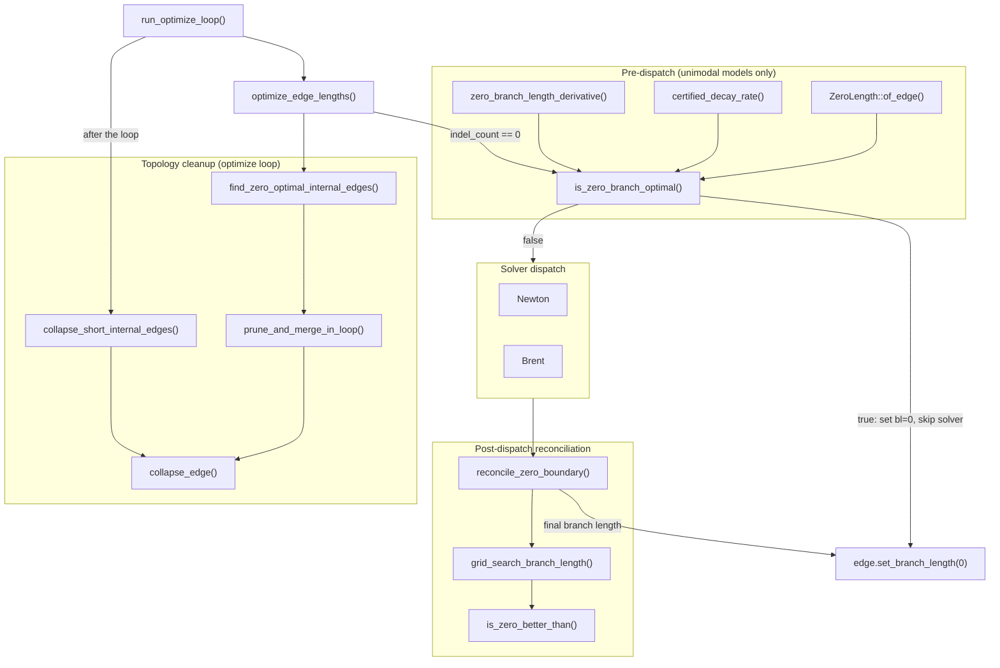

# Zero branch length optimization

How TreeTime v1 decides when an edge has zero optimal branch length, handles boundary conditions, and collapses degenerate edges. The central files are [optimize/dispatch.rs](../../packages/treetime/src/optimize/dispatch.rs) and [optimize/zero_boundary.rs](../../packages/treetime/src/optimize/zero_boundary.rs).

## Model classification

Whether the zero-branch shortcut applies depends on the substitution model. `fn GTR::certified_decay_rate()` ([gtr/gtr.rs#L130-L132](../../packages/treetime/src/gtr/gtr.rs#L130-L132)) records this classification: it returns the decay rate shared by every nonzero eigenvalue, and `None` for other models. `fn GTR::new()` sets the unit decay rate when all exchangeabilities are equal and positive ([gtr/gtr.rs#L100](../../packages/treetime/src/gtr/gtr.rs#L100), `fn has_equal_positive_exchangeabilities()` [gtr/gtr.rs#L246](../../packages/treetime/src/gtr/gtr.rs#L256)).

JC69 (`fn jc69()` [gtr/get_gtr.rs#L120](../../packages/treetime/src/gtr/get_gtr.rs#L120)), F81 (`fn f81()` [gtr/get_gtr.rs#L167](../../packages/treetime/src/gtr/get_gtr.rs#L167)), binary models (equal exchangeabilities by construction), and every other model with equal positive exchangeabilities, such as TN93 selected by name with its default `kappa1 = kappa2 = 1`, are classified as unimodal [1](#gloss-1). K80, HKY85, and T92 selected by name (default kappa 0.1) and general GTR with unequal exchangeabilities are not. The theoretical basis is [Dinh and Matsen 2017](https://doi.org/10.1214/16-AAP1240) [[1](#ref-1)], Corollary 3.1: models with a single distinct nonzero eigenvalue have at most one stationary point on $(0, \infty)$.

This classification drives the entire zero-branch pipeline. Unimodal models get a cheap derivative test. Non-unimodal models skip the test and rely on post-solver grid search to catch boundary errors.

## Per-edge optimization pipeline

Each edge goes through three phases inside `fn optimize_edge()` ([optimize/dispatch.rs#L234](../../packages/treetime/src/optimize/dispatch.rs#L234), called by `optimize_edge_lengths()` [optimize/dispatch.rs#L22](../../packages/treetime/src/optimize/dispatch.rs#L22)): input protection, the optimizer itself, and post-optimization reconciliation.

### Phase 1: Input domain protection

Before the optimizer runs, `ZeroLength::of_edge()` ([optimize/zero_boundary.rs#L21](../../packages/treetime/src/optimize/zero_boundary.rs#L21)) classifies whether a zero branch length is admissible for the edge: `ExcludedBySites` when some site has $L_i(0) \leq 0$, `ExcludedByIndels` when the edge has indels and no held length, and `Admissible` otherwise. `start_branch_length()` ([optimize/zero_boundary.rs#L35](../../packages/treetime/src/optimize/zero_boundary.rs#L35)) then keeps a positive input and moves a zero input into the evaluator's well-defined domain.

**Indel-bearing edges.** The Poisson derivative diverges at $t = 0$ when $k > 0$, where $t$ is the branch length and $k$ is the indel count on the edge. A zero starting point becomes $\max(k / \text{rate}, 1/L)$ (or $1/L$ when the indel rate is zero), where $L$ is the total alignment length across all partitions.

**Invalid-at-zero edges.** When any site has $L_i(0) \leq 0$ (where $L_i$ is the per-site likelihood, computed as $L_i(0) = \sum_c k_{ic}$ with $k_{ic}$ being the eigenvalue-space coefficients), evaluating $\ln L_i$ produces $-\infty$. A zero starting point becomes $1/L$.

During optimization, `min_branch_length_for_indels()` ([optimize/zero_boundary.rs#L54](../../packages/treetime/src/optimize/zero_boundary.rs#L54)) provides a floor for Newton/Brent steps: $0.01/L$ for indel-bearing edges, $0$ otherwise.

### Phase 2: Pre-dispatch shortcut

Before dispatching to a solver, `is_zero_branch_optimal()` ([optimize/zero_boundary.rs#L62](../../packages/treetime/src/optimize/zero_boundary.rs#L62)) checks whether the edge can be set to zero immediately ([optimize/dispatch.rs#L244](../../packages/treetime/src/optimize/dispatch.rs#L244)). The caller first requires that the edge has no indels (`indels.count == 0`). The function then requires three conditions to hold simultaneously:

1. Zero is admissible for the edge: `ZeroLength::of_edge()` returned `Admissible`, so every site has positive finite likelihood at $t = 0$ (`all_sites_valid_at_zero()`, [partition/optimize/contribution.rs#L58-L63](../../packages/treetime/src/partition/optimize/contribution.rs#L58-L63)) and no indel term requires a positive length
2. Every partition uses a unimodal model with the same certified decay rate (`certified_decay_rate()`, [partition/optimize/contribution.rs#L72-L74](../../packages/treetime/src/partition/optimize/contribution.rs#L72-L74); `shared_certified_decay_rate()`, [optimize/zero_boundary.rs#L160](../../packages/treetime/src/optimize/zero_boundary.rs#L160))
3. The total derivative of log-likelihood at $t = 0$ is finite and negative

The derivative is computed by `zero_branch_length_derivative()` ([partition/optimize/contribution.rs#L76-L86](../../packages/treetime/src/partition/optimize/contribution.rs#L76-L86)):

$$\frac{d}{dt} \log L(0) = \sum_i m_i \frac{\sum_c k_{ic} \lambda_c}{\sum_c k_{ic}}$$

where $m_i$ is the multiplicity of site pattern $i$ and $\lambda_c$ are the GTR eigenvalues. This is a weighted average of eigenvalues per site, summed over all sites.

If the derivative is negative, the log-likelihood decreases as $t$ moves away from zero, and unimodality guarantees zero is the global maximum. The edge is set to zero and the solver is skipped. If any condition fails, the edge falls through to Newton/Brent.

### Phase 3: Post-dispatch reconciliation

After the solver returns a candidate branch length, `reconcile_zero_boundary()` ([optimize/zero_boundary.rs#L79](../../packages/treetime/src/optimize/zero_boundary.rs#L79)) checks for three failure modes:

1. Positive but worse than zero. The solver returned a tiny positive value (e.g. $10^{-12}$) when zero has higher likelihood. Brent's method places a strictly positive lower bound on the bracket, so it cannot return exact zero even when zero is optimal. Detected by `is_zero_better_than()` ([optimize/zero_boundary.rs#L146](../../packages/treetime/src/optimize/zero_boundary.rs#L146)), which compares the log-likelihood at zero against $\log L(t)$ at the candidate.

2. Exactly zero on a non-unimodal model. Newton/Brent clamped to zero via step limiting, but a better positive mode may exist. The K80 counterexample from [Dinh and Matsen 2017](https://doi.org/10.1214/16-AAP1240) [[1](#ref-1)] with transition/transversion ratio $\kappa = 3$ has a local maximum at $t \approx 0.167$, a local minimum at $t \approx 1.25$, and its global maximum at $t \approx 6.37$ (values from the exact coefficients of the test fixture, `fn make_dinh_matsen_k80_contribution()` in `optimize/__tests__/test_dispatch_zero_boundary.rs`). A solver that clamps to zero from a starting point $t_0 \approx 0.6$ misses the local maximum. The reconcile step finds the local maximum only because it lies inside the grid; the global maximum lies outside the grid and outside v0's search range $t \leq 4$, and the tests of this path assert a positive point that beats zero within the grid, not the global maximum.

3. Exactly zero with invalid evaluation domain. The solver returned zero on a partition where $L_i(0) \leq 0$. The caller bumped the input away from zero (Phase 1), but step clamping brought it back. Preserving this zero would re-enter the invalid domain on the next marginal update.

All three cases route to `grid_search_branch_length()` ([optimize/zero_boundary.rs#L101](../../packages/treetime/src/optimize/zero_boundary.rs#L101)), which evaluates 100 log-spaced candidates produced by `grid_search_branch_lengths()` ([optimize/zero_boundary.rs#L132](../../packages/treetime/src/optimize/zero_boundary.rs#L132)). The grid spans from $0.1/L$ to $\max(1.5t + 1/L, 0.5)$, with log spacing providing uniform resolution per decade across the 3-4 orders of magnitude that branch lengths span. The grid search compares its best positive candidate against zero and returns whichever has higher log-likelihood.

## Topology cleanup

After branch-length optimization, the optimize loop collapses zero-length edges and restructures the tree; after the loop, it collapses short edges once.

`find_zero_optimal_internal_edges()` ([optimize/run_loop.rs#L302](../../packages/treetime/src/optimize/run_loop.rs#L302)) runs after `optimize_edge_lengths()` and before damping ([optimize/run_loop.rs#L237](../../packages/treetime/src/optimize/run_loop.rs#L237)). It collects every internal edge with branch length exactly zero, also when the edge carries Fitch substitutions or indels, because the transition matrix at length zero is the identity and the removal leaves the substitution likelihood unchanged. It keeps an edge only when the indel term of the edge needs a positive length (`IndelTerm::requires_positive_length()`: the edge has indel events and indels are part of the likelihood, which `--no-indels` turns off). Leaf edges are excluded, matching v0's `prune_short_branches` which skips terminals.

`prune_and_merge_in_loop()` ([optimize/run_loop.rs#L318](../../packages/treetime/src/optimize/run_loop.rs#L318)) then overrides damped branch lengths back to zero for these edges and collapses each one. The underlying `collapse_edge()` ([optimize/topology/collapse.rs#L21](../../packages/treetime/src/optimize/topology/collapse.rs#L21)) removes the target node, reparents its children to the source, sums branch lengths, composes substitutions via the Markov semigroup property (reversions cancel), composes the marginal estimates of the two edges, concatenates indels, and drops stale partition entries. A composed Fitch substitution at a site where the child subtree has no data is dropped. `collapse_edge()` is also used by the prune command ([prune/prune.rs#L77](../../packages/treetime/src/prune/prune.rs#L77), [prune/prune.rs#L136](../../packages/treetime/src/prune/prune.rs#L136)).

After collapsing, `resolve_polytomies()` merges siblings that share substitutions of both Fitch and the marginal reconstruction under new internal nodes, hoists reverting children, and retires mutation-free helper nodes ([kb/decisions/optimize-polytomy-reversion-resolution.md](../decisions/optimize-polytomy-reversion-resolution.md)). A merge creates an edge that the next branch-length step can drive to zero; when the collapse removes it, `MergeLedger` rejects the same group of children for the rest of the run, so the loop does not repeat the merge.

After the loop, on the final branch lengths, `collapse_short_internal_edges()` ([optimize/topology/collapse.rs#L84](../../packages/treetime/src/optimize/topology/collapse.rs#L84)) collapses every internal edge of length zero and every internal edge shorter than $0.1/L$ ($L$ is the number of sites of all partitions) whose marginal estimate carries no substitution in any partition, except edges whose indel term needs a positive length. This is the post-loop `prune_short_branches` of v0 marginal mode. No merge or hoist follows. `--no-collapse-short-branches` disables both collapses.

## Data flow

## Decision matrix

| Model class                          | Indels  | Sites valid at zero | Path                                                                                          |
| ------------------------------------ | ------- | ------------------- | --------------------------------------------------------------------------------------------- |
| Unimodal (JC69, F81, binary)         | none    | yes                 | Derivative shortcut. Negative derivative -> zero. Otherwise solver.                           |
| Unimodal                             | none    | no                  | Solver with bumped start ($1/L$). Post-dispatch reconciliation if solver returns zero.        |
| Unimodal                             | present | any                 | Solver with Poisson floor. Zero never optimal (Poisson $-\infty$).                            |
| Non-unimodal (K80, HKY85, T92 at default kappa, GTR with unequal exchangeabilities) | none    | yes                 | Solver. Post-dispatch grid search if solver returns zero or a positive value worse than zero. |
| Non-unimodal                         | none    | no                  | Solver with bumped start. Post-dispatch grid search if solver returns zero (invalid domain).  |
| Non-unimodal                         | present | any                 | Solver with Poisson floor. Zero never optimal.                                                |

## Glossary

1.  **Unimodal (branch-length likelihood).** A per-edge log-likelihood function with at most one local maximum on $(0, \infty)$. Proven for models with a single distinct nonzero eigenvalue: JC69, F81, and binary symmetric models ([Dinh and Matsen 2017](https://doi.org/10.1214/16-AAP1240) [[1](#ref-1)], Corollary 3.1). Models with multiple distinct nonzero eigenvalues (K80, HKY85, TN93, GTR) can have two local maxima. [↩](#gloss-use-1)

## References

1.  Dinh, Vu, and Frederick A. Matsen IV. 2017. "The Shape of the One-Dimensional Phylogenetic Likelihood Function." _Annals of Applied Probability_ 27(3):1646-1677. https://doi.org/10.1214/16-AAP1240 [↩¹](#cite-1a) [↩²](#cite-1b)
